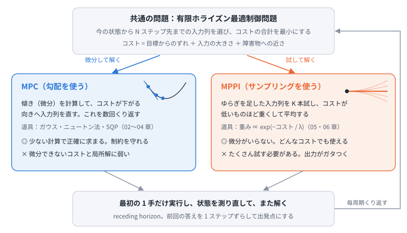
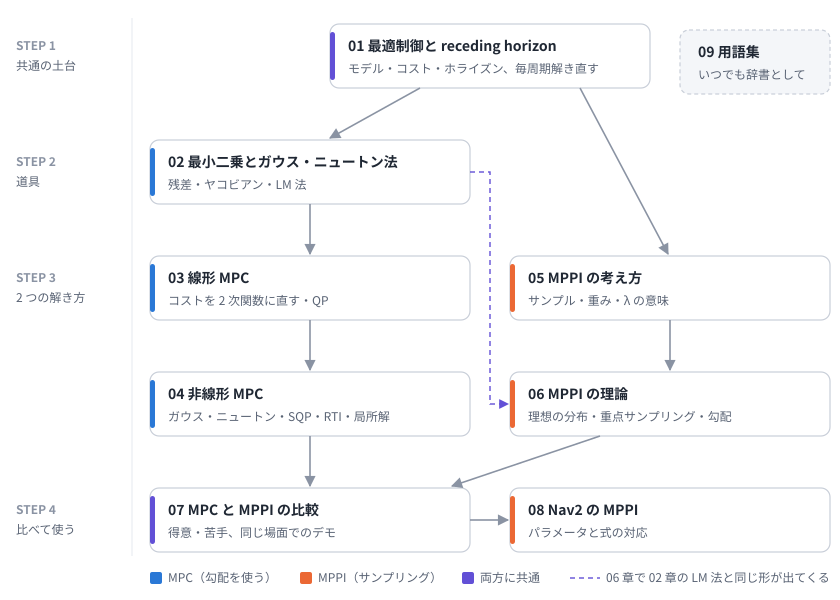
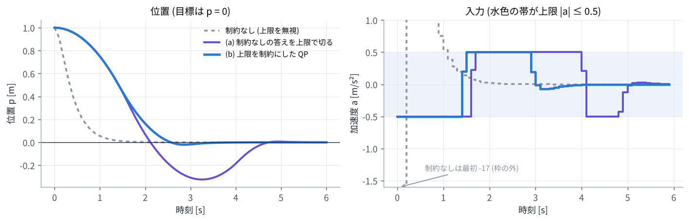

# study_mpc_mppi — MPC × MPPI 学習ノート

**MPC (モデル予測制御)** と **MPPI (Model Predictive Path Integral)** を、数式から順に理解するための学習環境です。**解説 (Markdown / HTML)** と **手を動かす演習 (Python)** で、ロードマップに沿って 1 つずつ進めます。

> MPC も MPPI も、「少し先までの動きを予測し、コストがいちばん小さい入力の列を選び、最初の 1 手だけ実行する」をくり返します。
> 違うのは、いちばん良い入力の列の探し方だけです。MPC は微分を使って直し、MPPI はたくさん試して重みつき平均します。



## 読み方は 2 通り

| 形式 | 場所 | 特徴 |
| --- | --- | --- |
| Markdown | [`docs/`](docs/00_roadmap.md) | GitHub 上でそのまま読める (数式も表示される) |
| HTML | [Web 版](https://mamoru1126.github.io/study_mpc_mppi/html/) / [`html/index.html`](html/index.html) | 目次・読了チェック付き。**ニュートン法・MPPI の重み・ぼかしたコスト・NMPC と MPPI の比較** を動かせるインタラクティブデモ入り |

HTML 版の開き方:

- **Web で読む**: <https://mamoru1126.github.io/study_mpc_mppi/html/>
- **ローカル**: クローンして `html/index.html` をブラウザで開くだけ (数式表示用の KaTeX を同梱しているのでオフラインでも読めます)

## 学習ロードマップ



| 章 | 内容 | 演習 |
| --- | --- | --- |
| [00 学習ロードマップ](docs/00_roadmap.md) | MPC と MPPI をひとことで。共通の問題と知識の地図 | - |
| [01 最適制御問題と receding horizon](docs/01_optimal_control.md) | モデル・コスト・ホライズン、最初の 1 手だけ実行して毎周期解き直す理由 | ex01 |
| [02 最小二乗とガウス・ニュートン法](docs/02_least_squares_gauss_newton.md) | 残差とヤコビアン、ニュートン法、ガウス・ニュートン法、LM 法 | ex02 |
| [03 線形 MPC](docs/03_linear_mpc.md) | 未来の状態を入力の列の 1 次式に、コストを 2 次関数に。制約と QP | ex03 |
| [04 非線形 MPC](docs/04_nonlinear_mpc.md) | 連鎖律でヤコビアン、shooting、SQP、RTI、局所解と微分できないコスト | ex04 |
| [05 MPPI の考え方](docs/05_mppi_basics.md) | 試す・評価する・重みをつける・平均する。λ と実効サンプル数 | ex05 |
| [06 MPPI の理論](docs/06_mppi_theory.md) | 理想の分布、重点サンプリング、ぼかしたコストの坂、LM 法との対応 | ex06 |
| [07 MPC と MPPI の比較](docs/07_comparison.md) | 式とアルゴリズムの左右対比、得意・苦手、同じ場面でのデモ | - |
| [08 Nav2 の MPPI](docs/08_nav2_mppi.md) | パラメータと式の対応、critic、調整の考え方 | - |
| [09 用語集](docs/09_glossary.md) | 日本語・英語の対応表 | - |

## 演習の環境構築

ROS も GPU も不要です。Python 3.9 以上で動きます。

```bash
git clone https://github.com/mamoru1126/study_mpc_mppi.git
cd study_mpc_mppi
python3 -m venv .venv
source .venv/bin/activate
pip install -r requirements.txt
python exercises/check_env.py
```

図の日本語が □ になる場合は、日本語フォントを入れてください (Ubuntu: `sudo apt install fonts-noto-cjk`)。

### make で一括実行

```bash
make check       # 環境の確認
make exercises   # 演習 ex01〜ex06 を全部実行 (図を docs/figures に保存)
make figures     # 概念図 (docs/figures/fig_*.svg) を作り直す
make html        # docs/ から html/ を再生成
```

## 演習の一覧

詳しくは [`exercises/README.md`](exercises/README.md) を見てください。

| 演習 | 内容 |
| --- | --- |
| `ex01_receding_horizon.py` | モデルが知らない横風の中で、「1 回だけ計画」と「毎周期計画し直す」を比べる |
| `ex02_gauss_newton.py` | ニュートン法、ガウス・ニュートン法の 1 回目を数値で確認、最急降下法・LM 法との比較 |
| `ex03_linear_mpc.py` | 線形 MPC の $H$, $F$ を手計算と照合。上限で切る制御と QP の比較 |
| `ex04_nmpc.py` | 連鎖律のヤコビアンの確認、反復ごとの計画、局所解と段差のコストでの失敗 |
| `ex05_mppi.py` | 重みの手計算、1 回の更新のサンプルと重み、λ の効果 |
| `ex06_mppi_theory.py` | ぼかしたコストの坂とサンプル数の誤差、2 次のコストで LM 法と同じ形になることの確認 |

演習 4・5 のコントローラ (`exercises/robot2d.py`) は、HTML 版のデモ (`tools/site/ctrl.js`) と同じパラメータです。

演習 3 の結果 (加速度に上限があるとき、制約なしの答えを上限で切ると止まりきれずに行き過ぎ、上限を制約にした QP は早めに減速する):



## ディレクトリ構成

```
.
├── docs/                 解説 (Markdown) と図 (docs/figures)
├── html/                 HTML 版 (tools/build_html.py で docs/ から生成)
├── exercises/            Python 演習 (numpy / scipy / matplotlib)
├── tools/
│   ├── build_html.py     HTML 生成スクリプト
│   ├── make_diagrams.py  概念図 (fig_*.svg) の生成スクリプト
│   └── site/             HTML のスタイル・デモ・KaTeX
├── index.html            html/ へ移動するだけのページ (GitHub Pages のトップ)
├── requirements.txt
└── Makefile
```

## 注意

- Nav2 のパラメータ名と既定値は、2026 年 11 月に確認したドキュメントによります。版によって変わるので、使う版のドキュメントを確認してください。
- 演習はすべて実行して結果を確認済みです (Python 3.13, numpy 2.5, scipy 1.18, matplotlib 3.11)。
- HTML 版に同梱している KaTeX は MIT ライセンスです (`tools/site/katex/LICENSE.txt`)。
