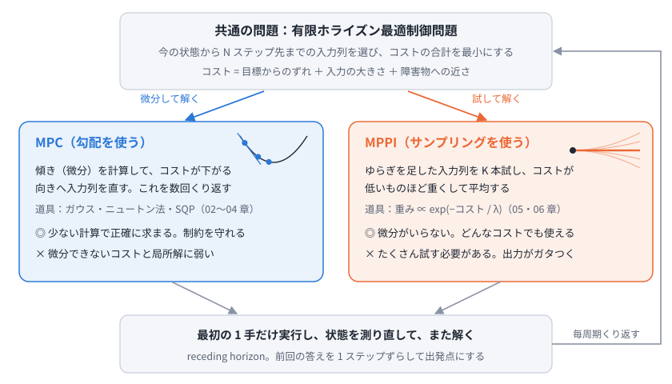
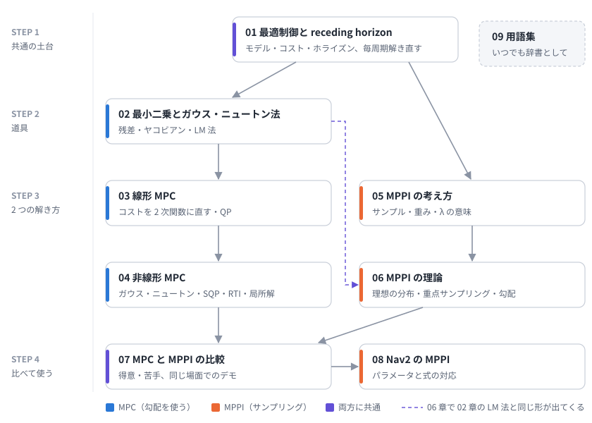

# 00. 学習ロードマップ

この教材は、移動ロボットの制御でよく使われる 2 つの方法、**MPC (モデル予測制御)** と **MPPI (Model Predictive Path Integral)** を、数式から順に理解するためのものです。終わったときに、次のことができるようになるのが目標です。

- 2 つの方法が「同じ問題を、違うやり方で解いている」ことを説明できる
- MPC の中身 (最小二乗、ガウス・ニュートン法、QP、SQP) を説明できる
- MPPI の重みつき平均の式と、λ の意味を説明できる
- Nav2 の MPPI のパラメータが、式のどこに当たるか分かる

## ひとことで言うと

**MPC も MPPI も、「少し先までの動きをモデルで予測し、コストがいちばん小さくなる入力の列を選び、最初の 1 手だけ実行する」をくり返します。違うのは、いちばん良い入力の列の探し方だけです。**

- **MPC**: コストの傾き (微分) を計算して、良くなる向きへ入力の列を少しずつ直す
- **MPPI**: 入力の列をランダムにずらしたものをたくさん試し、コストが低いものほど重くして平均する



## 中心にある 1 つの問題

どちらの方法も、制御の周期ごとに次の **有限ホライズン最適制御問題** を解きます。

```math
\begin{aligned}
\min_{u_0, \dots, u_{N-1}} \quad & J = \sum_{t=0}^{N-1} \ell(x_t, u_t) + \phi(x_N) \\
\text{s.t.} \quad & x_{t+1} = f(x_t, u_t), \quad x_0 = \hat{x} \\
& u_{\min} \le u_t \le u_{\max}
\end{aligned}
```

| 記号 | 意味 | 詳しくは |
| --- | --- | --- |
| $x_t$, $u_t$ | 時刻 $t$ の状態 (位置と向き) と入力 (速度と角速度) | [01 章](01_optimal_control.md) |
| $f$ | ロボットのモデル。今の状態と入力から次の状態を計算する | [01 章](01_optimal_control.md) |
| $\ell$, $\phi$ | 各時刻のコストと、最後の時刻のコスト | [01 章](01_optimal_control.md) |
| $N$ | ホライズン (何ステップ先まで考えるか) | [01 章](01_optimal_control.md) |
| $\hat{x}$ | 今の状態 (センサから推定したもの) | [01 章](01_optimal_control.md) |
| $\min$ の解き方 (MPC) | 傾きを使って入力の列を直す | [02 章](02_least_squares_gauss_newton.md), [03 章](03_linear_mpc.md), [04 章](04_nonlinear_mpc.md) |
| $\min$ の解き方 (MPPI) | 試して、重みつき平均する | [05 章](05_mppi_basics.md), [06 章](06_mppi_theory.md) |

この問題の解き方が 2 通りある、というのがこの教材の骨組みです。

## 必要な知識の地図



| 章 | 内容 | 演習 | 目安 |
| --- | --- | --- | --- |
| [01 最適制御問題と receding horizon](01_optimal_control.md) | モデル・コスト・ホライズン、毎周期解き直す理由 | ex01 | 1 時間 |
| [02 最小二乗とガウス・ニュートン法](02_least_squares_gauss_newton.md) | 残差とヤコビアン、ガウス・ニュートン法、LM 法 | ex02 | 2 時間 |
| [03 線形 MPC](03_linear_mpc.md) | コストを入力列の 2 次関数に直す、制約と QP | ex03 | 1.5 時間 |
| [04 非線形 MPC](04_nonlinear_mpc.md) | 連鎖律でヤコビアン、shooting、SQP、RTI、局所解 | ex04 | 2 時間 |
| [05 MPPI の考え方](05_mppi_basics.md) | サンプルと重み、λ の意味、アルゴリズム | ex05 | 1.5 時間 |
| [06 MPPI の理論](06_mppi_theory.md) | 理想の分布、重点サンプリング、ぼかしたコストの坂 | ex06 | 2 時間 |
| [07 MPC と MPPI の比較](07_comparison.md) | 式の対応、得意・苦手、同じ場面でのデモ | - | 1 時間 |
| [08 Nav2 の MPPI](08_nav2_mppi.md) | パラメータと式の対応、調整の考え方 | - | 1 時間 |
| [09 用語集](09_glossary.md) | 日本語と英語の対応 | - | 辞書として |

## おすすめの進め方

1. **01 章で「解きたい問題」を固める。** ここが両方の方法の土台です。
2. **MPC の列 (02 → 03 → 04) を読む。** 02 章の道具 (ガウス・ニュートン法) を、03 章で線形の場合、04 章で非線形の場合に使います。
3. **MPPI の列 (05 → 06) を読む。** 06 章では、02 章の LM 法と同じ形の式が出てきます。
4. **07 章で比べ、08 章で実際の Nav2 の設定に結びつける。**

急ぐ場合は、目的に合わせて章を選んでもかまいません。

- MPPI を使いたいだけ: 01 → 05 → 07 → 08
- MPC だけ知りたい: 01 → 02 → 03 → 04 → 07

各章の最後にある「理解度チェック」で、説明できるかを確かめながら進めてください。

## 前提知識

- 微分 (偏微分、連鎖律)、行列とベクトルの積、転置、逆行列
- 確率の基本 (正規分布、期待値)
- Python と numpy が少し読めると、演習が楽になります

分からない言葉が出てきたら [09 用語集](09_glossary.md) を見てください。

## 学習を始める前の準備

リポジトリのトップの [README](../README.md) に従って Python の環境を作り、次を実行してください。

```bash
python exercises/check_env.py
```

演習はすべて numpy / scipy / matplotlib だけで動きます。ROS は不要です。

## 理解度チェック (最終目標)

この教材を終えたとき、次の質問に答えられるようになっているはずです。

1. MPC と MPPI は、何が同じで何が違うか?
2. 計画した入力の列のうち、最初の 1 手しか実行しないのはなぜか?
3. ガウス・ニュートン法の式 $J^\top J\,\Delta = -J^\top r$ の各項は何を表すか?
4. 入力に上限があるとき、「制約なしで解いた答えを上限で切る」だけではいけないのはなぜか?
5. 非線形 MPC が、真正面に立つ人の手前で止まってしまうのはなぜか?
6. MPPI の λ を小さくしすぎる・大きくしすぎると、それぞれ何が起きるか?
7. MPPI の更新が「ぼかしたコストの坂を下っている」と言えるのはなぜか?
8. Nav2 の `temperature`、`batch_size`、`time_steps`、`model_dt` は、式のどこに当たるか?

---

次へ: [01 最適制御問題と receding horizon](01_optimal_control.md)
