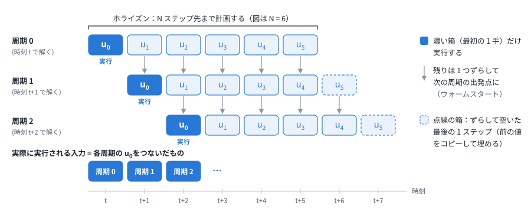
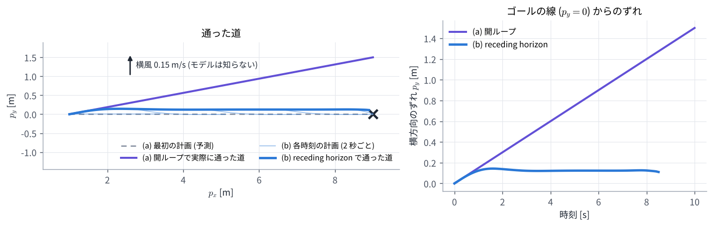

# 01. 最適制御問題と receding horizon

## この章のゴール

- ロボットの動きを、離散時間のモデル $x_{t+1} = f(x_t, u_t)$ で書ける
- 「良い動き」を、コストの合計として書ける
- 有限ホライズン最適制御問題の各部分が何を表すか説明できる
- 計画した入力の列の最初の 1 手だけを実行し、毎周期解き直す (receding horizon) 理由が分かる

> **つながり**
> この章で作る最適制御問題は、MPC ([02〜04 章](02_least_squares_gauss_newton.md)) と MPPI ([05・06 章](05_mppi_basics.md)) の両方が解く「共通の問題」です。
> この章では解き方には触れず、問題の形だけを固めます。

---

## 0. この章で使う記号

| 記号 | 意味 | この教材の 2 輪ロボットでは |
| --- | --- | --- |
| $x_t$ | 時刻 $t$ の状態 | 位置 $(p_x, p_y)$ と向き $\theta$ |
| $u_t$ | 時刻 $t$ の入力 | 速度 $v$ と角速度 $\omega$ |
| $\Delta t$ | 1 ステップの時間 | 0.1 秒 |
| $f$ | モデル (次の状態を計算する式) | 下の式 (1) |
| $N$ | ホライズン (何ステップ先まで考えるか) | 30 ステップ (3 秒) |
| $\ell$, $\phi$ | 各時刻のコスト、最後の時刻のコスト | 目標からのずれの 2 乗など |
| $U$ | 入力の列 $(u_0, \dots, u_{N-1})$ | 2 × 30 = 60 個の数 |
| $\hat{x}$ | 今の状態 (センサから推定したもの) | |

## 1. ロボットのモデル

### 1.1 差動 2 輪のモデル

この教材では、左右の車輪の速さを変えて進む・曲がるロボット (差動 2 輪) を例にします。
状態は位置と向き、入力は前に進む速度と回る角速度です。

```math
\underbrace{\begin{bmatrix} p_{x,t+1} \\ p_{y,t+1} \\ \theta_{t+1} \end{bmatrix}}_{x_{t+1}}
=
\underbrace{\begin{bmatrix} p_{x,t} \\ p_{y,t} \\ \theta_t \end{bmatrix}}_{x_t}
+ \Delta t \begin{bmatrix} v_t \cos\theta_t \\ v_t \sin\theta_t \\ \omega_t \end{bmatrix}
\qquad (1)
```

意味は「$\Delta t$ 秒のあいだ、今の向き $\theta_t$ の方向に $v_t \Delta t$ だけ進み、$\omega_t \Delta t$ だけ回る」です。
連続時間の運動を短い時間で区切って近似したもので、まとめて $x_{t+1} = f(x_t, u_t)$ と書きます。

### 1.2 数値で 2 ステップ進めてみる

$x_0 = (0, 0, 0)$ (原点で $x$ 軸の向き) から、入力 $u = (v, \omega) = (1.0, 0.5)$ を 2 回続けます ($\Delta t = 0.1$)。

```math
\begin{aligned}
x_1 &= x_0 + 0.1\,(1.0 \cos 0,\ 1.0 \sin 0,\ 0.5) \\
&= (0.1,\ 0,\ 0.05) \\[6pt]
x_2 &= x_1 + 0.1\,(1.0 \cos 0.05,\ 1.0 \sin 0.05,\ 0.5) \\
&= (0.1999,\ 0.0050,\ 0.10)
\end{aligned}
```

1 ステップ目で向きが 0.05 rad 変わったので、2 ステップ目は少し左 ($+p_y$) へ進んでいます。

### 1.3 ロールアウト: 入力の列が決まれば未来が決まる

入力の列 $U = (u_0, \dots, u_{N-1})$ を決めれば、式 (1) を順に当てはめるだけで、未来の状態 $x_1, \dots, x_N$ が全部決まります。
これを **ロールアウト** と呼びます。

ここが大事な点です。**私たちが選べるのは入力の列 $U$ だけで、未来の状態はその結果として決まる** と考えます。
ですから「良い動きを探す」とは「良い入力の列を探す」ことです。

## 2. コスト: 「良い動き」を数で表す

### 2.1 各時刻のコスト

「良い動き」を、悪さの合計が小さい動きとして表します。この教材のデモでは、各時刻の悪さ (段コスト) を次の 3 つの和にしています。

```math
\begin{aligned}
\ell(x_t, u_t) = {} & q_{\mathrm{ref}} \lVert p_t - p_t^{\mathrm{ref}} \rVert^2 + q_\omega\, \omega_t^2 \\
& + q_o \sum_i \max\bigl(0,\ d_{\mathrm{s}} - \lVert p_t - o_{i,t} \rVert \bigr)^2
\end{aligned}
```

| 項 | 意味 | デモの重み |
| --- | --- | --- |
| $\lVert p_t - p_t^{\mathrm{ref}} \rVert^2$ | 目標点からのずれ。目標点の列は、ゴールへ向かう直線の上を 0.8 m/s で進む点 | $q_{\mathrm{ref}} = 1$ |
| $\omega_t^2$ | 回りすぎ。ふらふらした動きを抑える | $q_\omega = 0.1$ |
| $\max(0, d_{\mathrm{s}} - \lVert p_t - o_{i,t} \rVert)^2$ | 人 $i$ の予測位置 $o_{i,t}$ から安全距離 $d_{\mathrm{s}} = 1.05$ m より内側に入った深さの 2 乗。外にいれば 0 | $q_o = 40$ |

数値で確かめます。ある時刻に、目標点から 0.2 m ずれていて、$\omega = 0.5$ rad/s で回っていて、人との距離が 0.85 m だとすると

```math
\begin{aligned}
\ell &= 1 \times 0.2^2 + 0.1 \times 0.5^2 + 40 \times (1.05 - 0.85)^2 \\
&= 0.04 + 0.025 + 1.6 = 1.665
\end{aligned}
```

人の安全距離に 0.2 m 入り込むと、目標から 0.2 m ずれるのの 40 倍の罰になります。**重みの比が、何をどれだけ優先するかを決めます。**

### 2.2 最後の時刻のコスト (終端コスト)

ホライズンの最後の状態 $x_N$ には、別の重みをつけます。

```math
\phi(x_N) = q_T \lVert p_N - p_N^{\mathrm{ref}} \rVert^2, \qquad q_T = 5
```

ホライズンの外 (3 秒より先) のことは考えないので、その代わりに「最後の時点で目標から離れていたら強く罰する」ことで、先のことを少しだけ反映します。

### 2.3 なぜ 2 乗にするのか

- 0 のときに最小で、なめらか (微分できる)。そのため、コストを「ずれの 2 乗の和」と見て、[02 章](02_least_squares_gauss_newton.md) のガウス・ニュートン法がそのまま使える
- 大きなずれほど強く罰する

なお、MPPI はコストが 2 乗の形でなくてもかまいません (段差のようなコストでも使えます)。これは [05 章](05_mppi_basics.md) の大事な性質です。

### 2.4 制約

コストとは別に、守らなければならない条件 (制約) もあります。

- 入力の上下限: デモでは $0 \le v \le 1$ m/s、$-1.5 \le \omega \le 1.5$ rad/s
- 状態の制約: 「人から一定距離以上離れる」「壁にぶつからない」など

デモでは、状態の制約は 2.1 の第 3 項のように **罰 (コスト)** として入れています。破ってもよいが破ると高くつく、という扱いです (ソフト制約)。
絶対に守らせる扱い (ハード制約) もあり、MPC は得意ですが、MPPI は苦手です ([07 章](07_comparison.md))。

## 3. 有限ホライズン最適制御問題

ここまでをまとめると、次の問題になります。

```math
\begin{aligned}
\min_{u_0, \dots, u_{N-1}} \quad & J = \sum_{t=0}^{N-1} \ell(x_t, u_t) + \phi(x_N) \\
\text{s.t.} \quad & x_{t+1} = f(x_t, u_t) \quad (t = 0, \dots, N-1) \\
& x_0 = \hat{x} \\
& u_{\min} \le u_t \le u_{\max}
\end{aligned}
\qquad (2)
```

読み方:

- **変数は入力の列だけ** です。2 輪ロボットで $N = 30$ なら $2 \times 30 = 60$ 個の数を選びます
- $x_0 = \hat{x}$: 今の状態から予測を始めます
- $x_{t+1} = f(x_t, u_t)$: 未来はモデルで予測します。モデルが現実とずれていれば、予測も外れます
- **有限**: $N$ ステップ先までしか考えません。デモでは $N \Delta t = 30 \times 0.1 = 3$ 秒先まで
- 解くと、最適な入力の列 $U^* = (u_0^*, \dots, u_{N-1}^*)$ と、それで予測した軌道が得られます

この問題を **有限ホライズン最適制御問題** (finite-horizon optimal control problem、OCP) と呼びます。

### 3.1 ホライズンの長さ

- 短すぎると、障害物に気づくのが遅れます。デモでは 3 秒・0.8 m/s なので、2.4 m 先までしか見えません
- 長すぎると、計算が重くなり、遠い未来の予測は外れやすくなります
- 参考: Nav2 の MPPI の既定は 56 ステップ × 0.05 秒 = 2.8 秒です ([08 章](08_nav2_mppi.md))

## 4. receding horizon: 最初の 1 手だけ実行して、解き直す

式 (2) を解くと 3 秒分の入力の列が得られますが、**実行するのは最初の $u_0^*$ だけ** です。

1. 今の状態 $\hat{x}$ を測る (推定する)
2. 式 (2) を解いて $U^* = (u_0^*, \dots, u_{N-1}^*)$ を得る
3. $u_0^*$ だけを $\Delta t$ 秒間実行する
4. 1 に戻る (時刻が 1 ステップ進んだので、考える範囲も 1 ステップ先へずれる)

考える範囲 (ホライズン) が時間とともに後ろへ下がっていくので、**receding horizon** (後退ホライズン) と呼びます。
この「予測して、最初の 1 手だけ実行して、また予測する」のくり返しが、**モデル予測制御** (MPC) の意味です。



### 4.1 なぜ全部を実行しないのか

モデルは現実と完全には一致しませんし、予想しない外乱もあります。毎周期、測り直した状態から計画し直せば、ずれをその都度直せます (フィードバック)。

演習 1 で確かめます。ロボットは $p_y = 0$ の線に沿ってゴール $(9, 0)$ へ進みたいのですが、**モデルが知らない横風** ($+p_y$ 向きに 0.15 m/s) が吹いています。

- (a) 開ループ: 最初に 10 秒分の入力の列を 1 回だけ計画し、そのまま実行する
- (b) receding horizon: 3 秒先まで計画し、最初の 1 手だけ実行して、0.1 秒ごとに計画し直す



| | 結果 |
| --- | --- |
| (a) 開ループ | 計画の上ではゴールにぴったり着くが、実際は 10 秒後に 1.50 m ずれた所にいる |
| (b) receding horizon | 8.5 秒でゴールに着く (0.2 m 以内)。横のずれは最大 0.14 m |

(b) の細い線は各時刻の計画で、どれも「線に戻る」計画になっています。風に押されるたびに計画し直すので、ずれがたまりません。
ずれが 0 にならず約 0.12 m 残るのは、モデルが風を知らないからです。風をモデルに入れれば打ち消せます。

### 4.2 ウォームスタート: 前回の答えを使い回す

計画し直すとき、ゼロから解く必要はありません。前回の答えを 1 ステップずらしたもの

```math
(u_1^*, u_2^*, \dots, u_{N-1}^*, u_{N-1}^*)
```

を出発点 (初期値) にします。最後の 1 ステップは空くので、最後の値をコピーして埋めます。
前回の答えは今回の答えにかなり近いので、少ない計算で済みます。これを **ウォームスタート** と呼びます。
MPC でも MPPI でも、この工夫が速さの鍵になります。

### 4.3 1 周期に使える時間

制御の周期が 10 Hz なら、測る・解く・送るを全部 0.1 秒以内に終える必要があります。Nav2 の MPPI は 20〜50 Hz 程度で動かします。
**「速く、そこそこ良い答えを毎周期出す」** ことが求められる、というのが、両方の方法の設計を決めています。

## 5. 2 つの解き方の予告

| | MPC (勾配を使う) | MPPI (サンプリングを使う) |
| --- | --- | --- |
| 入力の列の直し方 | 傾き (微分) から改善の向きを計算する | ランダムにずらした列を試し、重みつき平均する |
| 1 周期の計算 | 数回の反復。毎回、連立 1 次方程式や QP を解く | $K$ 本のロールアウト (並列にできる) |
| 中心の道具 | ガウス・ニュートン法 ([02 章](02_least_squares_gauss_newton.md)) | 重み $e^{-S/\lambda}$ ([05 章](05_mppi_basics.md)) |

ここから、MPC の列 (02〜04 章) と MPPI の列 (05・06 章) に分かれます。どちらから読んでもかまいません。

## 演習 1

```bash
python exercises/ex01_receding_horizon.py
```

開ループと receding horizon を比べ、図 `docs/figures/ex01_receding_horizon.png` を作ります。最適化の中身は 02〜04 章で扱うので、この演習では scipy の汎用ソルバーに任せています。

試してみること:

- `WIND` を `(0.0, 0.3)` にすると、(b) のずれはどうなるか
- `receding_horizon()` の `N` を 10 (1 秒先まで) にすると、動きはどう変わるか

## 理解度チェック

1. 2 輪のモデルで、$x_0 = (0, 0, \pi/2)$、$u = (1.0, 0)$、$\Delta t = 0.1$ のとき $x_1$ は?
2. 式 (2) の変数は何か。2 輪ロボットで $N = 30$ なら、変数はいくつか?
3. 終端コスト $\phi$ は何のためにあるか?
4. 計画した $N$ 個の入力のうち 1 つしか実行しないのはなぜか。残りは捨ててよいか?
5. ホライズンを長くすると何が良くなり、何が悪くなるか?
6. 演習 1 で、receding horizon でも横のずれが 0 にならないのはなぜか?

<details markdown="1">
<summary>答えの例</summary>

1. 向きが $\pi/2$ ($+p_y$ 向き) なので、$x_1 = (0 + 0.1 \cos\frac{\pi}{2},\ 0 + 0.1 \sin\frac{\pi}{2},\ \frac{\pi}{2}) = (0, 0.1, \pi/2)$。
2. 入力の列 $U = (u_0, \dots, u_{N-1})$ だけ。状態はモデルで決まる。$u_t = (v_t, \omega_t)$ なので $2 \times 30 = 60$ 個。
3. ホライズンの外のことを考えない代わりに、最後の状態が目標から離れていることを強く罰して、先のことを少し反映するため。
4. モデルが現実と一致せず外乱もあるので、測り直した状態から毎周期計画し直すため (フィードバック)。残りは捨てずに、1 ステップずらして次の計算の初期値に使う (ウォームスタート)。
5. 良くなる点: 遠くの障害物や目標に早く気づける。悪くなる点: 計算が重くなり、遠い未来の予測が外れやすくなる。
6. モデルが横風を知らないので、毎回「線に戻る」計画を立てても、実行すると風に押される。押される量と戻す量がつり合う所で、ずれが一定 (約 0.12 m) になる。

</details>

## もっと知りたい人へ

- J. B. Rawlings, D. Q. Mayne, M. M. Diehl, *Model Predictive Control: Theory, Computation, and Design*, 2nd ed., Nob Hill Publishing, 2017. 第 1 章が MPC の考え方の入門です。

---

前へ: [00 学習ロードマップ](00_roadmap.md) ｜ 次へ: [02 最小二乗とガウス・ニュートン法](02_least_squares_gauss_newton.md)
