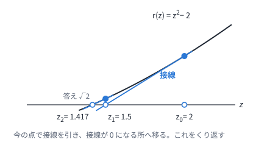
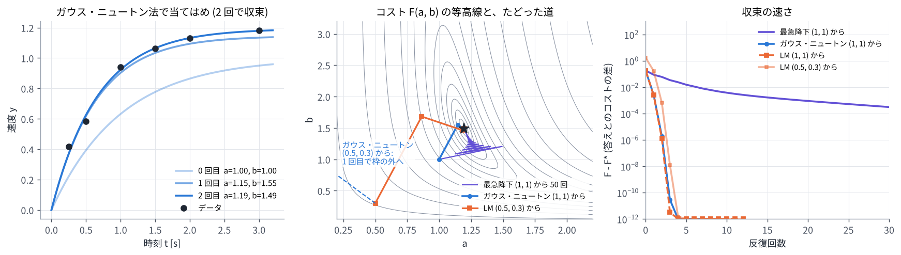

# 02. 最小二乗とガウス・ニュートン法

## この章のゴール

- コストを「残差の 2 乗和」$F(z) = \frac12 \lVert r(z) \rVert^2$ の形で書ける
- 残差が 1 つのときのニュートン法 (接線で 0 を探す) が分かる
- ガウス・ニュートン法の式 $J^\top J\,\Delta = -J^\top r$ を導けて、各項の意味を説明できる
- LM 法の減衰 $\mu$ の役割が分かる

> **つながり**
> MPC の多くは、[01 章](01_optimal_control.md) のコストを「残差の 2 乗和」と見て、この章のガウス・ニュートン法やその仲間で解きます。
> さらに [06 章](06_mppi_theory.md) では、MPPI の更新が、この章の LM 法と同じ形の式になることを見ます。

---

## 0. この章で使う記号

| 記号 | 意味 |
| --- | --- |
| $z$ | 変数 ($n$ 個の数を並べたベクトル)。MPC では入力の列 $U$ |
| $r(z)$ | 残差ベクトル。0 にしたい「ずれ」を $m$ 個並べたもの |
| $F(z) = \frac12 \lVert r(z) \rVert^2$ | コスト (残差の 2 乗和の半分。$\frac12$ は微分をきれいにするためで、答えは変わらない) |
| $J = \partial r / \partial z$ | ヤコビアン。$m \times n$ の行列で、$i$ 行 $j$ 列は「$z_j$ を少し動かすと $r_i$ がどれだけ変わるか」 |
| $\Delta$ | 1 回の反復で $z$ を直す量 |
| $\mu$ | LM 法の減衰 (慎重さのつまみ) |

## 1. 最小二乗: ずれを並べて 2 乗和にする

### 1.1 例: モーターの速度の立ち上がり

モーターに一定の電圧をかけると、速度は $y(t) = a\,(1 - e^{-bt})$ のように立ち上がります。$a$ は最終的な速度、$b$ は立ち上がりの速さです。
6 回測ったデータから $a$ と $b$ を求めます。

| $t$ [s] | 0.25 | 0.5 | 1.0 | 1.5 | 2.0 | 3.0 |
| --- | --- | --- | --- | --- | --- | --- |
| $y$ | 0.416 | 0.582 | 0.941 | 1.062 | 1.131 | 1.182 |

測定ごとのずれ (残差) は $r_i(a, b) = a\,(1 - e^{-b t_i}) - y_i$ です。ノイズがあるので 6 個のずれを全部 0 にはできません。そこで、2 乗和を最小にします。

```math
F(a, b) = \frac12 \sum_{i=1}^{6} r_i(a, b)^2
```

### 1.2 01 章のコストも同じ形

[01 章](01_optimal_control.md) のコストは、重みの平方根をかけたずれの 2 乗の和に書き直せます。

```math
\begin{aligned}
& q_{\mathrm{ref}} \lVert p_t - p_t^{\mathrm{ref}} \rVert^2 + q_\omega\, \omega_t^2 + \cdots \\
&= \bigl\lVert \sqrt{q_{\mathrm{ref}}}\,(p_t - p_t^{\mathrm{ref}}) \bigr\rVert^2 + \bigl(\sqrt{q_\omega}\, \omega_t\bigr)^2 + \cdots
\end{aligned}
```

ですから、これらを全時刻ぶん縦に並べたものを残差ベクトル $r(U)$ とすれば、01 章の最適制御問題もこの章の形 $\lVert r(U) \rVert^2$ になります ([04 章](04_nonlinear_mpc.md))。

### 1.3 残差が $z$ の 1 次式なら一発で解ける

残差が $r(z) = Az - b$ の形 ($A$ は定数の行列) なら、コストは $z$ の 2 次関数なので、勾配を 0 とおけば答えが出ます。

```math
\nabla F = A^\top (Az - b) = 0 \quad \Longrightarrow \quad A^\top A\, z = A^\top b
```

これを **正規方程式** と呼びます。[03 章](03_linear_mpc.md) の線形 MPC は、この形で解けます。
残差が非線形 (1.1 の例や、2 輪ロボット) のときは、このあと説明するように反復が必要です。

## 2. 残差が 1 つ: ニュートン法 (接線で 0 を探す)

まず一番簡単な場合として、変数も残差も 1 つで、$r(z) = 0$ を解く問題を考えます。
今の点 $z$ のまわりで $r$ を接線 (1 次式) で近似し、接線が 0 になる所へ移ります。

```math
r(z + \Delta) \approx r(z) + r'(z)\,\Delta = 0
\quad \Longrightarrow \quad
z \leftarrow z - \frac{r(z)}{r'(z)}
```



$r(z) = z^2 - 2$ (答えは $\sqrt2 = 1.414214\cdots$) で、$z_0 = 2$ から始めると、次のようになります。

| 反復 | $z$ | $r(z)$ | 答えとの差 |
| --- | --- | --- | --- |
| 0 | 2.000000 | 2.000000 | 0.586 |
| 1 | 1.500000 | 0.250000 | 0.0858 |
| 2 | 1.416667 | 0.006944 | 0.00245 |
| 3 | 1.414216 | 0.000006 | 0.0000021 |

答えに近づくほど接線の近似が正確になり、合っている桁数がおよそ倍々に増えます (2 次収束)。
一方、答えから遠い所では接線の近似が外れ、遠くへ飛ばされることがあります。下のデモの「arctan z」で、$z_0$ を 1.4 より大きくして確かめてください。

<!-- demo:newton -->

> **HTML 版** では、ここでニュートン法を 1 回ずつ進めるデモを動かせます → [Web 版の 02 章](https://mamoru1126.github.io/study_mpc_mppi/html/02_least_squares_gauss_newton.html)

## 3. ガウス・ニュートン法

### 3.1 考え方: 残差を 1 次式で近似して、1.3 の方法で解く

残差が $m$ 個、変数が $n$ 個の一般の場合に広げます。手順は 3 つです。

1. 今の $z$ のまわりで、残差を 1 次式で近似する: $r(z + \Delta) \approx r + J\Delta$
2. 近似した残差の 2 乗和を最小にする $\Delta$ を求める。$\Delta$ の 1 次式の残差なので、1.3 の正規方程式で一発で求まる
3. $z \leftarrow z + \Delta$ として、1 に戻る

```math
\begin{gathered}
\Delta = \arg\min_{\Delta}\ \frac12 \lVert r + J\Delta \rVert^2 \\
\Longleftrightarrow \quad J^\top J\, \Delta = -J^\top r \qquad (1)
\end{gathered}
```

式 (1) の導き方: $\frac12 \lVert r + J\Delta \rVert^2 = \frac12 r^\top r + \Delta^\top J^\top r + \frac12 \Delta^\top J^\top J \Delta$ を $\Delta$ で微分して 0 とおくと、$J^\top r + J^\top J\Delta = 0$ です。

### 3.2 各項の意味

| 項 | 意味 |
| --- | --- |
| $J$ ($m \times n$) | $i$ 行目は「変数を少しずつ動かしたとき、残差 $r_i$ がどれだけ変わるか」 |
| $g = J^\top r$ | コストの勾配 $\nabla F$。どちらへ動くとコストが増えるか |
| $J^\top J$ ($n \times n$) | コストの曲がり具合 (ヘッセ行列) の近似。曲がりがきつい方向には少し、ゆるい方向には大きく動く |

変数も残差も 1 つなら、$\Delta = -r\,r' / r'^2 = -r / r'$ となり、2 章のニュートン法と同じになります。

### 3.3 数値で 1 回やってみる

1.1 の例で、$(a, b) = (1, 1)$ から始めます。
残差の微分は $\partial r_i / \partial a = 1 - e^{-b t_i}$、$\partial r_i / \partial b = a\, t_i e^{-b t_i}$ です。

```math
r = \begin{bmatrix} -0.195 \\ -0.189 \\ -0.309 \\ -0.285 \\ -0.266 \\ -0.232 \end{bmatrix},
\quad
J = \begin{bmatrix} 0.221 & 0.195 \\ 0.393 & 0.303 \\ 0.632 & 0.368 \\ 0.777 & 0.335 \\ 0.865 & 0.271 \\ 0.950 & 0.149 \end{bmatrix}
```

```math
\begin{gathered}
J^\top J = \begin{bmatrix} 2.857 & 1.031 \\ 1.031 & 0.473 \end{bmatrix},
\quad
J^\top r = \begin{bmatrix} -0.985 \\ -0.411 \end{bmatrix} \\
\Longrightarrow \quad
\Delta = \begin{bmatrix} 0.146 \\ 0.552 \end{bmatrix}
\end{gathered}
```

残差がすべて負 (モデルがデータより小さい) なので、$a$ と $b$ を両方大きくする向きに動きます。
新しい点は $(a, b) = (1.146, 1.552)$ で、コストは次のように減ります。

| 反復 | 0 | 1 | 2 | 3 |
| --- | --- | --- | --- | --- |
| $F$ | 0.187 | 0.00473 | 0.00216 | 0.00216 |

2 回でほぼ収束し、$a = 1.193$、$b = 1.491$ になります (データは $a = 1.2$、$b = 1.5$ にノイズを足して作りました)。

### 3.4 ニュートン法との違い: 2 階微分を捨てている

$F = \frac12 \lVert r \rVert^2$ の本当のヘッセ行列は次の形です。

```math
\nabla^2 F = J^\top J + \sum_{i=1}^{m} r_i\, \nabla^2 r_i
```

ニュートン法はこれを全部使いますが、ガウス・ニュートン法は第 2 項を捨てます。そのおかげで

- 2 階微分を計算しなくてよい
- $J^\top J$ は必ず半正定値なので、$J$ の列が独立なら $\Delta$ は必ずコストが下がる向きを向く

という利点があります。捨てた項は残差 $r_i$ に比例するので、答えの近くで残差が小さいときや、残差が 1 次式に近いときは小さく、ニュートン法とほぼ同じ速さで収束します。
演習 2 では、答えの近くで $J^\top J$ の対角が 3.65 と 0.25 なのに対し、捨てた項は 0.001 程度でした。

### 3.5 最急降下法との比較

勾配の逆向きに一定の歩幅で進む最急降下法 $\Delta = -\alpha J^\top r$ と比べます (演習 2)。



- 最急降下法 (紫) は、等高線が細長い谷をジグザグに進み、50 回でも収束しきらない
- ガウス・ニュートン法 (青) は、曲がり具合 $J^\top J$ で歩幅と向きを補正するので、2 回で答えに着く

## 4. LM 法: うまくいかないときは慎重に

### 4.1 ガウス・ニュートン法が暴れる場合

答えから遠い所では 1 次式の近似が外れ、$\Delta$ が大きすぎてコストが上がることがあります。
演習 2 で $(a, b) = (0.5, 0.3)$ から始めると、ガウス・ニュートン法のコストは 1.7 → 25 → 0.23 → 7,500,000 → … と暴れます (図の中央の点線)。

### 4.2 減衰を足す

そこで、$J^\top J$ に減衰の項を足します。

```math
\begin{gathered}
(J^\top J + \mu D)\, \Delta = -J^\top r \qquad (2) \\
D = I \ \text{または}\ \operatorname{diag}(J^\top J)
\end{gathered}
```

- $\mu$ が大きいと $\Delta \approx -\frac{1}{\mu} D^{-1} J^\top r$ となり、小さな歩幅の最急降下法 (慎重)
- $\mu$ が小さいとガウス・ニュートン法 (大胆)

$\mu$ は次の規則で毎回調整します。この教材のコードでは、下がったら 1/3 倍、上がったら 4 倍にしています。

1. 式 (2) で $\Delta$ を求め、$F(z + \Delta)$ を計算する
2. 下がったら受け入れて、$\mu$ を小さくする (次はもっと大胆に)
3. 上がったら捨てて、$\mu$ を大きくして 1 に戻る (もっと慎重に)

これを **Levenberg–Marquardt (LM) 法** と呼びます。$(0.5, 0.3)$ からでも、コストは 1.7 → 0.17 → 0.0028 → 0.0022 と 3 回で収束します。

### 4.3 方法のまとめ

| 方法 | 1 回のステップ | 必要なもの | 答えの近くでの速さ |
| --- | --- | --- | --- |
| 最急降下法 | $\Delta = -\alpha J^\top r$ | 1 階微分 | 遅い |
| ガウス・ニュートン法 | $\Delta = -(J^\top J)^{-1} J^\top r$ | 1 階微分 ($J$) | 残差が小さいほど速い |
| LM 法 | $\Delta = -(J^\top J + \mu D)^{-1} J^\top r$ | 1 階微分 ($J$) | $\mu$ で上の 2 つの間を動く |
| ニュートン法 | $\Delta = -(\nabla^2 F)^{-1} \nabla F$ | 2 階微分 | 速い (2 次収束) |

### 4.4 変数に上下限があるとき

入力には上下限があります。この教材のコードでは、ステップのあとに上下限で切る (射影する) という簡単な方法を使っています。
きちんと扱うには、上下限を制約にした 2 次計画問題 (QP) を毎回解きます ([03 章](03_linear_mpc.md)、[04 章](04_nonlinear_mpc.md) の SQP)。

## 5. MPC への橋渡し

- 線形モデルと 2 次コストなら、残差は入力の列 $U$ の 1 次式なので、ガウス・ニュートン法は 1 回で答えに着く → [03 章](03_linear_mpc.md)
- 非線形モデルなら、ガウス・ニュートン法 (LM 法) を反復する → [04 章](04_nonlinear_mpc.md)
- そのときのヤコビアン $J$ は、モデルの微分の積 (連鎖律) で作る → [04 章](04_nonlinear_mpc.md)

## 演習 2

```bash
python exercises/ex02_gauss_newton.py
```

ニュートン法の表、ガウス・ニュートン法の 1 回目の数値 (3.3 節)、3 つの方法の収束を出力し、図を作ります。

試してみること:

- 出発点を `(2.0, 0.2)` や `(1.0, 6.0)` に変えて、ガウス・ニュートン法と LM 法を比べる
- `levenberg_marquardt()` の `mu / 3` と `mu *= 4` を変えると、収束はどう変わるか

## 理解度チェック

1. $F(z) = \frac12 \lVert r(z) \rVert^2$ の勾配を $J$ と $r$ で書くと?
2. ガウス・ニュートン法が捨てている項は何か。なぜ捨ててもうまくいくことが多いのか?
3. $J^\top J$ が逆行列を持たないと何が困るか。LM 法はそれをどう助けるか?
4. LM 法で $\mu$ を大きくすると、ステップはどうなるか?
5. $r(z) = z^2 - 2$ で $z_0 = 1$ から始めると、ニュートン法の $z_1$ はいくつか?
6. 残差がすべて $z$ の 1 次式なら、ガウス・ニュートン法は何回で収束するか?

<details markdown="1">
<summary>答えの例</summary>

1. $\nabla F = J^\top r$。
2. 本当のヘッセ行列の第 2 項 $\sum_i r_i \nabla^2 r_i$ (2 階微分の項)。残差 $r_i$ に比例するので、答えの近くで残差が小さいときや、残差が 1 次式に近いときは小さい。
3. 式 (1) が解けない (ある方向に動いても残差が変わらず、どれだけ動けばよいか決まらない)。LM 法は $\mu D$ を足すので、$J^\top J + \mu D$ は ($\mu > 0$ で $D$ が正の対角なら) 必ず逆行列を持つ。
4. 歩幅が小さくなり、向きは勾配の逆向き (最急降下法) に近づく。
5. $r(1) = -1$、$r'(1) = 2$ なので $z_1 = 1 - (-1)/2 = 1.5$。
6. 1 回。1 次式の近似が正確なので、式 (1) の答えがそのまま最小点になる (1.3 の正規方程式と同じ)。

</details>

## もっと知りたい人へ

- J. Nocedal, S. J. Wright, *Numerical Optimization*, 2nd ed., Springer, 2006. 第 10 章が最小二乗問題 (ガウス・ニュートン法、LM 法) です。
- K. Madsen, H. B. Nielsen, O. Tingleff, *Methods for Non-Linear Least Squares Problems*, 2nd ed., IMM, DTU, 2004. LM 法の $\mu$ の調整などが丁寧に書かれた講義ノートです。

---

前へ: [01 最適制御問題と receding horizon](01_optimal_control.md) ｜ 次へ: [03 線形 MPC](03_linear_mpc.md)
