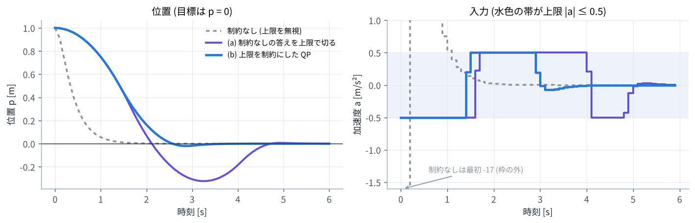

# 03. 線形 MPC (コストを 2 次関数に直す、QP)

## この章のゴール

- 線形モデルの MPC で、未来の状態を入力の列の 1 次式 $X = \Phi x_0 + \Gamma U$ で書ける
- コストが入力の列の 2 次関数 $J(U) = U^\top H U + 2 x_0^\top F^\top U + \text{定数}$ になることが分かり、制約がないときの答え $U^* = -H^{-1} F x_0$ を求められる
- 制約があると QP (2 次計画問題) になること、「制約なしの答えを切る」のとの違いが分かる

> **つながり**
> [02 章](02_least_squares_gauss_newton.md) で「残差が変数の 1 次式なら、一発で解ける」と見ました。線形 MPC はまさにその場合です。
> [04 章](04_nonlinear_mpc.md) の非線形 MPC は、毎回この章の形に近似して解きます。

---

## 0. この章で使う記号

| 記号 | 意味 |
| --- | --- |
| $A$, $B$ | 線形モデル $x_{t+1} = A x_t + B u_t$ の行列 |
| $Q$, $R$, $P$ | 状態・入力・最後の状態の重み行列 (対称で、$Q, P$ は半正定値、$R$ は正定値) |
| $X$, $U$ | 状態の列 $(x_1, \dots, x_N)$ と入力の列 $(u_0, \dots, u_{N-1})$ を縦に並べたもの |
| $\Phi$, $\Gamma$ | $X = \Phi x_0 + \Gamma U$ と書いたときの行列 |
| $\bar Q$, $\bar R$ | $Q$ (最後だけ $P$) と $R$ を対角に並べた大きな行列 |
| $H$, $F$ | コストを $U$ の 2 次関数で書いたときの行列 |

## 1. 線形モデルと 2 次コスト

モデルが線形で、コストが 2 次式の場合を考えます。目標は状態を 0 にすることとします (目標が 0 でなければ、$x$ を「目標とのずれ」と読み替えます)。

```math
\begin{gathered}
x_{t+1} = A x_t + B u_t \\
J = \sum_{t=0}^{N-1} \bigl( x_t^\top Q x_t + u_t^\top R u_t \bigr) + x_N^\top P x_N
\end{gathered}
```

例として、まっすぐなレールの上の台車を考えます。状態は位置 $p$ と速度 $v$、入力は加速度 $a$ です。

```math
\begin{bmatrix} p_{t+1} \\ v_{t+1} \end{bmatrix}
=
\underbrace{\begin{bmatrix} 1 & \Delta t \\ 0 & 1 \end{bmatrix}}_{A}
\begin{bmatrix} p_t \\ v_t \end{bmatrix}
+
\underbrace{\begin{bmatrix} \Delta t^2 / 2 \\ \Delta t \end{bmatrix}}_{B}
a_t
```

[01 章](01_optimal_control.md) の 2 輪ロボットは $\cos\theta$ や $\sin\theta$ を含むので線形ではありません。その場合は 04 章で扱います。

## 2. 未来の状態を入力の列で書く

モデルを順に代入していきます。

```math
\begin{aligned}
x_1 &= A x_0 + B u_0 \\
x_2 &= A x_1 + B u_1 = A^2 x_0 + AB\, u_0 + B u_1 \\
x_3 &= A x_2 + B u_2 = A^3 x_0 + A^2 B\, u_0 + AB\, u_1 + B u_2
\end{aligned}
```

縦に並べると、未来の状態は入力の列の 1 次式になります ($N = 3$ の場合)。

```math
\underbrace{\begin{bmatrix} x_1 \\ x_2 \\ x_3 \end{bmatrix}}_{X}
=
\underbrace{\begin{bmatrix} A \\ A^2 \\ A^3 \end{bmatrix}}_{\Phi} x_0
+
\underbrace{\begin{bmatrix} B & 0 & 0 \\ AB & B & 0 \\ A^2 B & AB & B \end{bmatrix}}_{\Gamma}
\underbrace{\begin{bmatrix} u_0 \\ u_1 \\ u_2 \end{bmatrix}}_{U}
```

$\Gamma$ が下三角なのは、**後の入力は前の状態に影響しない** からです ($u_2$ は $x_1$ や $x_2$ を変えられない)。
$\Gamma$ の $(t, s)$ ブロック $A^{t-s} B$ は「入力 $u_s$ を少し変えると、後の状態 $x_{t+1}$ がどれだけ変わるか」(感度) です。04 章では、これを非線形モデルに広げます。

## 3. コストを $U$ の 2 次関数にする

コストを行列で書くと $J = x_0^\top Q x_0 + X^\top \bar Q X + U^\top \bar R U$ です ($\bar Q = \operatorname{diag}(Q, \dots, Q, P)$、$\bar R = \operatorname{diag}(R, \dots, R)$)。
ここに $X = \Phi x_0 + \Gamma U$ を代入して整理すると

```math
\begin{gathered}
J(U) = U^\top H U + 2\, x_0^\top F^\top U + \text{定数} \qquad (1) \\
H = \Gamma^\top \bar Q\, \Gamma + \bar R, \quad F = \Gamma^\top \bar Q\, \Phi
\end{gathered}
```

と、$U$ の 2 次関数になります。$R$ が正定値なら $H$ も正定値なので、最小点はただ 1 つで、勾配を 0 とおけば求まります。

```math
\begin{gathered}
\nabla J = 2HU + 2F x_0 = 0 \\
\Longrightarrow \quad U^* = -H^{-1} F x_0 \qquad (2)
\end{gathered}
```

[02 章](02_least_squares_gauss_newton.md) の言葉で言えば、残差 $r(U) = \begin{bmatrix} \bar Q^{1/2} (\Phi x_0 + \Gamma U) \\ \bar R^{1/2} U \end{bmatrix}$ が $U$ の 1 次式なので、ガウス・ニュートン法が 1 回で答えに着く場合です ($J^\top J = H$ になります)。

### 3.1 手計算できる例

1 次元のモデル $x_{t+1} = x_t + u_t$ ($A = B = 1$)、$N = 2$、$Q = R = P = 1$ で計算してみます。

```math
\begin{gathered}
x_1 = x_0 + u_0, \quad x_2 = x_0 + u_0 + u_1 \\
\Longrightarrow \quad
\Phi = \begin{bmatrix} 1 \\ 1 \end{bmatrix}, \quad
\Gamma = \begin{bmatrix} 1 & 0 \\ 1 & 1 \end{bmatrix}
\end{gathered}
```

```math
\begin{aligned}
H &= \Gamma^\top \Gamma + I = \begin{bmatrix} 3 & 1 \\ 1 & 2 \end{bmatrix}, \quad
F = \Gamma^\top \Phi = \begin{bmatrix} 2 \\ 1 \end{bmatrix} \\[4pt]
U^* &= -H^{-1} F x_0 = -\frac15 \begin{bmatrix} 2 & -1 \\ -1 & 3 \end{bmatrix} \begin{bmatrix} 2 \\ 1 \end{bmatrix} x_0 \\
&= -\begin{bmatrix} 0.6 \\ 0.2 \end{bmatrix} x_0
\end{aligned}
```

$x_0 = 1$ なら $u_0 = -0.6$、$u_1 = -0.2$ で、$x_1 = 0.4$、$x_2 = 0.2$、コストは $J = 1 + 0.36 + 0.16 + 0.04 + 0.04 = 1.6$ です (最初の 1 は $x_0^2$ で、$U$ によらない定数)。
試しに $U = (-0.5, -0.25)$ にすると $J = 1.625$ で、確かに少し大きくなります。

### 3.2 receding horizon にすると線形フィードバックになる

毎周期 $u_0^* = -0.6\, x_0$ だけを実行すると、制御則は $u = -Kx$ ($K = 0.6$) という **状態の定数倍のフィードバック** になります。
閉ループは $x_{t+1} = x_t - 0.6\,x_t = 0.4\,x_t$ なので、状態は毎周期 0.4 倍になって 0 に近づきます。

一般に、**制約のない線形 MPC は、式 (2) の最初の行を取り出した $u = -Kx$ という線形フィードバックと同じ** です。$K$ は $H$ と $F$ から決まる定数なので、前もって計算しておけます。
演習 3 の台車では $K = (17.05,\ 7.95)$ で、「位置が 1 m ずれていたら $-17$ m/s² の加速度」という意味になります。
(ホライズンを無限に長くすると、LQR と呼ばれる最適なフィードバックに一致します。)

## 4. 制約があると QP になる

実際の入力には上下限があります。入力の上下限や状態の制約は、どれも $U$ の 1 次の不等式で書けます (状態は $X = \Phi x_0 + \Gamma U$ なので)。

```math
\min_{U}\ U^\top H U + 2\, x_0^\top F^\top U
\qquad \text{s.t.} \quad G U \le w + E x_0
```

2 次関数を 1 次の不等式のもとで最小化する問題を **2 次計画問題 (QP)** と呼びます。$H$ が正定値なら凸な QP なので、答えはただ 1 つで、専用のソルバーで速く確実に解けます。
ただし、答えはもう $x_0$ の 1 次式 $-H^{-1} F x_0$ ではありません (どの制約がぎりぎりで効いているかによって、場合分けされた 1 次式になります)。

### 4.1 「制約なしの答えを切る」ではだめな理由

演習 3 で、台車を位置 1 m から 0 へ止めます。$\Delta t = 0.1$ 秒、$N = 20$ (2 秒先まで)、加速度の上限は $|a| \le 0.5$ m/s² です。

- **制約なし**: 最初の入力は $-17.05$ m/s²。上限の 34 倍で、実行できない
- **(a) 制約なしの答えを上限で切る**: 毎周期、式 (2) の $u_0$ を $\pm 0.5$ に切って実行する
- **(b) QP**: 上限を制約にした QP を毎周期解く



| | 減速を始める時刻 | 最高速度 | 行き過ぎ (位置の最小値) |
| --- | --- | --- | --- |
| (a) 切る | 1.6 秒 | 0.80 m/s | −0.324 m |
| (b) QP | 1.4 秒 | 0.70 m/s | −0.021 m |

(a) は「最後に強くブレーキをかければ止まれる」という前提の計画を、毎回切って実行しています。いざブレーキが必要になると 0.5 m/s² しか出せないので止まりきれず、0.32 m 行き過ぎます。
(b) の QP は、ブレーキが 0.5 m/s² しか出せないことを知っているので、早めに減速を始めます。**制約を知った上で計画する** ことが、MPC が制約に強い理由です。

### 4.2 QP の解き方 (概要)

| 方法 | 考え方 | 例 |
| --- | --- | --- |
| 能動集合法 | どの制約がぎりぎりで効くかを推定し、等式制約の問題を解いて推定を直す。前回の答えから始めると速い | qpOASES |
| 内点法 | 制約の内側から、境界に近づくほど大きくなる罰を少しずつ弱めながら解く | HPIPM |
| 1 次の方法 | 勾配と射影のくり返し (ADMM など)。1 回が軽い | OSQP |

この章の式 (1) は状態を消去して $U$ だけの問題にしています (condensing)。状態も変数として残すと、行列が時刻ごとのブロックが並んだ疎な形になり、HPIPM のような専用ソルバーはホライズン長 $N$ に比例する時間で解けます。
演習 3 では簡単のため、上下限つきの最適化ができる scipy の L-BFGS-B を使っています。

## 5. 調整のつまみ

- **$Q$ を大きく**すると目標に強く追従し、**$R$ を大きく**すると入力がおだやかになる。効くのは比だけで、$Q$ と $R$ を両方 10 倍しても答えは変わらない
- **$N$ を長く**すると先を見越した動きになるが、計算が増える
- **終端の重み $P$** を適切に選ぶ (例えば LQR のリッカチ方程式の解にする) と、短いホライズンでも安定性を保証できる

## 演習 3

```bash
python exercises/ex03_linear_mpc.py
```

3.1 節の $H$、$F$、$U^*$ を確かめ、台車の 3 つの制御を比べた図を作ります。

試してみること:

- 加速度の上限 `amax` を 1.0 や 0.3 にすると、(a) と (b) の差はどう変わるか
- `R` を `0.01` にすると、制約なしの答えの大きさ ($K$) はどう変わるか

## 理解度チェック

1. $\Gamma$ が下三角になるのはなぜか?
2. 制約のない線形 MPC の答えが $x_0$ の 1 次式になるのはなぜか?
3. $Q$ と $R$ を両方 10 倍すると、答え $U^*$ はどうなるか?
4. 制約のある線形 MPC は、どんな最適化問題になるか。なぜ確実に解けるのか?
5. 制約なしの答えを上下限で切って実行すると、何が困るか?
6. 3.1 節の例で $N = 1$ にすると ($J = x_0^2 + u_0^2 + x_1^2$)、$u_0^*$ はいくつか?

<details markdown="1">
<summary>答えの例</summary>

1. 後の入力は前の状態に影響しない (因果性) ので、$x_{t+1}$ は $u_0, \dots, u_t$ だけに依存し、$u_{t+1}$ 以降の係数は 0 になるから。
2. コストが $U$ の 2 次関数で、勾配 $2HU + 2Fx_0$ が $U$ と $x_0$ の 1 次式なので、勾配 = 0 の答えも $x_0$ の 1 次式になるから。
3. 変わらない。$H$ と $F$ が両方 10 倍になり、$-H^{-1}F x_0$ は同じ。
4. 凸な 2 次計画問題 (QP)。$H$ が正定値なので、局所解がそのまま唯一の最適解になり、能動集合法や内点法で確実に解ける。
5. 制約を知らずに立てた計画なので、ぎりぎりまで減速しないなど、切られた入力では計画どおりに動けない。演習 3 では止まりきれずに 0.32 m 行き過ぎた。
6. $J = x_0^2 + u_0^2 + (x_0 + u_0)^2$ を $u_0$ で微分して 0 とおくと $2u_0 + 2(x_0 + u_0) = 0$ なので、$u_0^* = -x_0 / 2$ (= −0.5 $x_0$)。

</details>

## もっと知りたい人へ

- J. B. Rawlings, D. Q. Mayne, M. M. Diehl, *Model Predictive Control: Theory, Computation, and Design*, 2nd ed., 2017. 第 1〜2 章 (線形 MPC、安定性)、第 8 章 (数値解法)。
- F. Borrelli, A. Bemporad, M. Morari, *Predictive Control for Linear and Hybrid Systems*, Cambridge University Press, 2017. 制約つき線形 MPC と QP の解の構造。

---

前へ: [02 最小二乗とガウス・ニュートン法](02_least_squares_gauss_newton.md) ｜ 次へ: [04 非線形 MPC](04_nonlinear_mpc.md)
