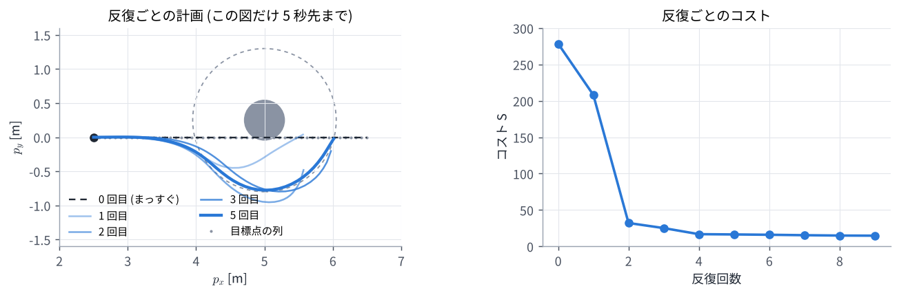
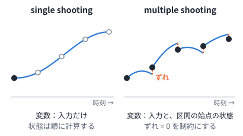
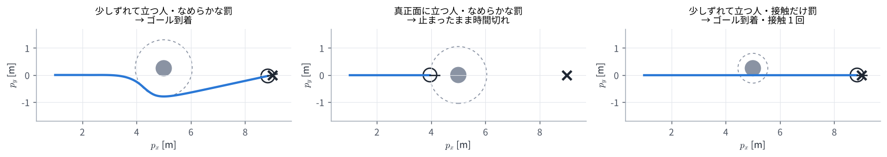

# 04. 非線形 MPC (NMPC)

## この章のゴール

- 非線形モデルの MPC を、残差の 2 乗和としてガウス・ニュートン法で解ける
- ヤコビアンを連鎖律で作れる: $\partial x_t / \partial u_s = A_{t-1} \cdots A_{s+1} B_s$
- single shooting と multiple shooting の違い、SQP と RTI の考え方が分かる
- 障害物のまわりで局所解に止まる理由と、微分できないコストが効かない理由が分かる

> **つながり**
> [02 章](02_least_squares_gauss_newton.md) のガウス・ニュートン法を、[01 章](01_optimal_control.md) の 2 輪ロボットの最適制御問題に当てはめます。
> [03 章](03_linear_mpc.md) の QP は、SQP の中で毎回解く小さな問題として出てきます。

---

## 0. この章で使う記号

| 記号 | 意味 |
| --- | --- |
| $A_t = \partial f / \partial x$, $B_t = \partial f / \partial u$ | モデルを $(x_t, u_t)$ で微分した行列 (今の案のまわりでの線形化) |
| $U$ | 入力の列 (最適化の変数)。2 輪で $N = 30$ なら 60 個 |
| $r(U)$ | 残差ベクトル。コストは $S(U) = \lVert r(U) \rVert^2$ |
| $J = \partial r / \partial U$ | 残差のヤコビアン |
| $d_{\mathrm{s}}$ | 安全距離 (人の中心から 1.05 m) |

## 1. 何が難しくなるのか

2 輪ロボットのモデルは $\cos\theta$ と $\sin\theta$ を含むので、未来の状態は入力の列の非線形な関数になります。
そのため、[03 章](03_linear_mpc.md) のようにコストを 2 次関数に直して一発で解くことはできません。

そこで、**今の案のまわりで線形に近似し、03 章のように解いて案を直す、をくり返します**。これが 02 章のガウス・ニュートン法そのものです。

## 2. 残差を並べる

01 章のコストを、残差の 2 乗の和に書き直します。各時刻の残差を縦に並べたものが $r(U)$ です。

```math
r(U) =
\begin{bmatrix}
\sqrt{q_{\mathrm{ref}}}\,(p_t - p_t^{\mathrm{ref}}) \\
\sqrt{q_T}\,(p_N - p_N^{\mathrm{ref}}) \\
\sqrt{q_\omega}\, \omega_t \\
\sqrt{q_o}\, \bigl(d_{\mathrm{s}} - \lVert p_t - o_t \rVert\bigr)
\end{bmatrix}
```

1 行目は $t = 1, \dots, N$、3 行目は $t = 0, \dots, N-1$ の全時刻ぶんを縦に並べます。4 行目 (人の罰) は、人の安全距離の内側にいる時刻だけ入れます。外にいる時刻は罰が 0 だからです。
こうすると $S(U) = \lVert r(U) \rVert^2$ が、ちょうど 01 章のコストになります。
演習 4 のある場面では、残差は 92 個 (行)、変数は 60 個 (列) でした。

## 3. ヤコビアンを連鎖律で作る

ガウス・ニュートン法には $J = \partial r / \partial U$ が必要です。残差は位置 $p_t$ から計算するので、「入力 $u_s$ を少し変えると、後の状態 $x_t$ がどれだけ変わるか」(感度) が分かればよいです。

### 3.1 変化が伝わる様子

入力 $u_s$ を $\delta u_s$ だけ変えると、

- 次の状態は $\delta x_{s+1} = B_s\, \delta u_s$ だけ変わる
- そこから先は、モデルを通るたびに $\delta x_{t+1} = A_t\, \delta x_t$ と伝わる

ので、

```math
\begin{gathered}
\frac{\partial x_t}{\partial u_s} = A_{t-1} A_{t-2} \cdots A_{s+1} B_s \quad (s < t) \qquad (1) \\
\frac{\partial x_t}{\partial u_s} = 0 \quad (s \ge t)
\end{gathered}
```

となります。後の入力は前の状態に影響しないので $s \ge t$ では 0 です。これは [03 章](03_linear_mpc.md) の $\Gamma$ のブロック $A^{t-s-1}B$ と同じ形で、違いは $A_t$, $B_t$ が時刻ごとに変わることだけです。

2 輪ロボットのモデル $f$ (01 章の式 (1)) を微分すると、次のようになります。

```math
\begin{gathered}
A_t = \begin{bmatrix} 1 & 0 & -v_t \sin\theta_t\, \Delta t \\ 0 & 1 & v_t \cos\theta_t\, \Delta t \\ 0 & 0 & 1 \end{bmatrix} \\[4pt]
B_t = \begin{bmatrix} \cos\theta_t\, \Delta t & 0 \\ \sin\theta_t\, \Delta t & 0 \\ 0 & \Delta t \end{bmatrix}
\end{gathered}
```

### 3.2 数値で確かめる

$\theta = 0$、$v = 1$、$\omega = 0$、$\Delta t = 0.1$ のまわりで、$u_0$ が 2 ステップ後の $x_2$ に与える影響を計算します。

```math
\begin{aligned}
\frac{\partial x_2}{\partial u_0} = A_1 B_0
&= \begin{bmatrix} 1 & 0 & 0 \\ 0 & 1 & 0.1 \\ 0 & 0 & 1 \end{bmatrix}
\begin{bmatrix} 0.1 & 0 \\ 0 & 0 \\ 0 & 0.1 \end{bmatrix} \\
&= \begin{bmatrix} 0.1 & 0 \\ 0 & 0.01 \\ 0 & 0.1 \end{bmatrix}
\end{aligned}
```

2 列目を読むと「$\omega_0$ を 1 rad/s 増やすと、2 ステップ後の $p_y$ が 0.01 m 増える」です。
$\omega_0$ で向きが 0.1 rad 変わり、そのあと 0.1 m 進むので、横に $0.1 \times 0.1 = 0.01$ m ずれる、という意味です。
演習 4 では、この方法で作った $J$ と数値微分の差が $1.8 \times 10^{-8}$ で、正しく作れていることを確かめています。

## 4. ガウス・ニュートン法で解く

あとは 02 章と同じです。前回の答えを 1 ステップずらした入力の列から始めて、次をくり返します。

```python
# U = (前回の答えを 1 ステップずらしたもの)
for it in range(iters):
    X = rollout(x_hat, U)                    # 予測
    r, J = residual_and_jacobian(X, U)       # 残差と、式 (1) で作ったヤコビアン
    H, g = J.T @ J, J.T @ r
    while True:                              # LM 法: 悪くなったら慎重に
        dU = solve(H + mu * diag(H), -g)
        U_new = clip(U + dU, u_min, u_max)   # 入力の上下限で切る
        if cost(U_new) < cost(U):
            U, mu = U_new, mu / 3
            break
        mu = mu * 4
send(U[0])                                   # 最初の 1 手だけ実行
U = shift(U)
```

演習 4 で、人の 2.5 m 手前から、まっすぐ進む案を出発点にして反復した様子です (この図だけ、人の向こうまで見えるようにホライズンを 5 秒にしています)。



コストは 278.6 → 208.1 → 32.1 → 25.1 → 16.7 と下がり、計画は人をよける形に変わっていきます。
実際の制御では、前回の答えから始めるので出発点がすでに答えに近く、1 周期に数回の反復で足ります。

## 5. 変数の置き方: single shooting と multiple shooting



| | single shooting | multiple shooting |
| --- | --- | --- |
| 変数 | 入力の列だけ | 入力の列と、区間ごとの始点の状態 |
| 状態 | モデルで順に計算する (1 本につながる) | 変数なので最初はつながっていなくてよい。「区間の終わり = 次の始点」を制約にする |
| 良い点 | 変数が少なく、いつもモデルどおりの軌道 | 最初の入力の影響が長く伝わらないので数値的に安定。状態の初期値を直接与えられる |
| 使われ方 | この教材のデモ・演習 | acados など、NMPC のソルバーの標準 |

single shooting では、最初のほうの入力が後の状態すべてに効くので、ホライズンが長いと $J$ の値の大きさがばらばらになり、解きにくくなります。

## 6. SQP: 毎回、QP を解いて直す

入力の上下限や状態の制約をきちんと守るには、各反復で「今の案のまわりで近似した QP」を解きます。今の案を $(\bar x_t, \bar u_t)$ として、直す量 $(\Delta x_t, \Delta u_t)$ を変数にした QP です。

```math
\begin{aligned}
\min_{\Delta x, \Delta u} \quad & \sum_{t} \tfrac12 \begin{bmatrix} \Delta x_t \\ \Delta u_t \end{bmatrix}^{\!\top} H_t \begin{bmatrix} \Delta x_t \\ \Delta u_t \end{bmatrix} + \nabla \ell_t^\top \begin{bmatrix} \Delta x_t \\ \Delta u_t \end{bmatrix} \\
\text{s.t.} \quad & \Delta x_0 = \hat{x} - \bar x_0, \\
& \Delta x_{t+1} = A_t\, \Delta x_t + B_t\, \Delta u_t + \bigl( f(\bar x_t, \bar u_t) - \bar x_{t+1} \bigr), \\
& g(\bar x_t, \bar u_t) + \nabla g_t^\top \begin{bmatrix} \Delta x_t \\ \Delta u_t \end{bmatrix} \le 0
\end{aligned}
```

- 1 行目: コストの 2 次近似。$H_t$ にガウス・ニュートン近似 $J_t^\top J_t$ を使えば、2 階微分がいらず、必ず凸な (確実に解ける) QP になる
- 2〜3 行目: モデルの線形化。$f(\bar x_t, \bar u_t) - \bar x_{t+1}$ は multiple shooting のつなぎ目のずれで、これも 0 に向かって直される
- 4 行目: 制約 $g \le 0$ の線形化

この QP を解いて案を直す、をくり返すのが **SQP** (逐次 2 次計画法) です。制約がなければ、ガウス・ニュートン近似の SQP は 4 節のガウス・ニュートン法と同じものです。
この QP は時刻ごとのブロックが鎖のようにつながった形なので、HPIPM などの専用ソルバーでホライズン長に比例する時間で解けます。SQP の代わりに、内点法 (IPOPT など) で元の問題をそのまま解く方法もあります。

## 7. RTI: 1 周期に 1 回だけ直す

**Real-Time Iteration (RTI)** は、制御の周期ごとに SQP の反復を 1 回だけ行い、続きは次の周期に持ち越す方法です。

- 前回の答えをずらした出発点はすでに答えに近いので、1 回でも十分に追いつける
- 状態を測る前に、線形化と QP の準備を済ませておく (準備段階)。測ったら QP を解くだけにして (フィードバック段階)、計算の遅れを小さくする

この教材のデモの NMPC は、1 周期に 3 回 (既定) だけガウス・ニュートン法を回しており、RTI に近い使い方です。

## 8. 苦手なこと

演習 4 で、毎周期 3 回反復しながら 3 つの場面を走らせた結果です。



| 場面 | 結果 |
| --- | --- |
| 少しずれて立つ人・なめらかな罰 | 10.4 秒でゴール。人との最小のすき間 0.47 m |
| 真正面に立つ人・なめらかな罰 | 人の手前で止まり、25 秒で時間切れ |
| 少しずれて立つ人・接触だけ罰 | 9.8 秒でゴールに着くが、途中で 1 回接触 (すき間 −0.30 m) |

### 8.1 局所解: 真正面の人の前で止まる

人がちょうど真正面にいると、コストは左右対称です。まっすぐ進む案のまわりでは、左へずれても右へずれてもコストの変わり方が同じなので、**勾配の横向きの成分がちょうど 0** になります。
ガウス・ニュートン法は勾配と曲がり具合だけを見るので、左右どちらへよけるかを決められません。
残る選択肢は「速度を落として安全距離の手前で止まる」で、これがその場の局所解 (近くでいちばん良い答え) になります。

制約として扱う SQP でも同じことが起きます。「人から $d_{\mathrm s}$ 以上離れる」は、左右どちらからよけてもよい (凸でない) 制約で、SQP では今の位置で線を引いた半平面に置きかえます。

```math
\begin{gathered}
n_t^\top (p_t - o) \ge d_{\mathrm{s}} \\
n_t = \frac{\bar p_t - o}{\lVert \bar p_t - o \rVert}
\end{gathered}
```

$n_t$ は、人から今の案の位置 $\bar p_t$ へ向かう単位ベクトルです。どちら側をよけるかは出発点で決まり、反対側のほうが良くてもそちらへは移れません。人が真正面にいると $n_t$ が進行方向と平行になり、横へ動く理由がなくなります。

### 8.2 微分できないコスト: 接触だけを罰すると気づかない

「接触したら 1 ステップごとに +1000、しなければ 0」という段差のコストは、ほとんどの場所で傾きが 0 です。
ガウス・ニュートン法は傾きから改善の向きを決めるので、この罰を見ることができず、人がいないかのように進んで接触します。

### 8.3 対策の例

- 左右それぞれの初期値から解いて、良いほうを使う
- 段差ではなく、なめらかな罰 ([01 章](01_optimal_control.md) 2.1 節の第 3 項のような形) にする
- サンプリングで良い初期値を見つけ、NMPC で仕上げる (MPPI → [05 章](05_mppi_basics.md))

下のデモで確かめてください。左が NMPC、右が MPPI です。「真正面の人」では NMPC が止まり、MPPI は回り込みます。

<!-- demo:duel:headon -->

> **HTML 版** では、ここでNMPC と MPPI を同じ場面で動かすデモを動かせます → [Web 版の 04 章](https://mamoru1126.github.io/study_mpc_mppi/html/04_nonlinear_mpc.html)

## 演習 4

```bash
python exercises/ex04_nmpc.py
```

ヤコビアンの確認 (3 節)、反復ごとの計画 (4 節)、3 つの場面の閉ループ (8 節) を出力し、図を 2 枚作ります。
コントローラ本体は `exercises/robot2d.py` の `NMPC` クラスです (HTML 版のデモと同じパラメータ)。

試してみること:

- `NMPC(scene, mode, iters=3)` の `iters` を 1 や 10 にすると、動きはどう変わるか
- 真正面の場面で、最初の入力の列 `V`, `W` に少し左へ曲がる値を入れると、止まらずによけられるか

## 理解度チェック

1. $\partial x_3 / \partial u_0$ を $A_t$ と $B_t$ で書くと? $u_5$ は $x_3$ に影響するか?
2. 3.2 節の例で、$v_0$ を 1 m/s 増やすと $x_2$ はどう変わるか?
3. single shooting と multiple shooting の違いは何か?
4. RTI は 1 周期に何をするか。なぜそれで足りるのか?
5. 真正面に立つ人の手前で NMPC が止まるのはなぜか?
6. 「接触したら +1000」のコストを、ガウス・ニュートン法が無視してしまうのはなぜか?

<details markdown="1">
<summary>答えの例</summary>

1. $\partial x_3 / \partial u_0 = A_2 A_1 B_0$。$u_5$ は $x_3$ より後の入力なので影響しない ($\partial x_3 / \partial u_5 = 0$)。
2. $A_1 B_0$ の 1 列目 $(0.1, 0, 0)$ より、$p_x$ だけが 0.1 m 増える (0.1 秒間に 0.1 m 余分に進む)。
3. single shooting は入力だけが変数で、状態はモデルで順に計算する。multiple shooting は区間の始点の状態も変数にし、つなぎ目が一致することを制約にする。後者のほうが数値的に安定。
4. SQP の反復を 1 回だけ行い、続きは次の周期に持ち越す。前回の答えをずらした出発点がすでに答えに近いので、1 回の改善でも追いつける。
5. 左右対称なので、まっすぐの案のまわりで勾配の横向きの成分が 0 になり、左右どちらへよけるかを決められない。速度を落として手前で止まる案が局所解になる。
6. 段差のコストはほとんどの場所で傾きが 0 なので、勾配と曲がり具合から作る改善の向きに、接触を避ける成分が入らないから。

</details>

## もっと知りたい人へ

- M. Diehl, H. G. Bock, J. P. Schlöder, "A Real-Time Iteration Scheme for Nonlinear Optimization in Optimal Feedback Control," *SIAM J. Control and Optimization*, 43(5), pp. 1714–1736, 2005. RTI の元の論文。
- S. Gros, M. Zanon, R. Quirynen, A. Bemporad, M. Diehl, "From linear to nonlinear MPC: bridging the gap via the real-time iteration," *International Journal of Control*, 93(1), pp. 62–80, 2020. 線形 MPC から RTI までのつながり。
- R. Verschueren et al., "acados—a modular open-source framework for fast embedded optimal control," *Mathematical Programming Computation*, 14, pp. 147–183, 2022.
- J. A. E. Andersson, J. Gillis, G. Horn, J. B. Rawlings, M. Diehl, "CasADi: a software framework for nonlinear optimization and optimal control," *Mathematical Programming Computation*, 11, pp. 1–36, 2019.

---

前へ: [03 線形 MPC](03_linear_mpc.md) ｜ 次へ: [05 MPPI の考え方](05_mppi_basics.md)
