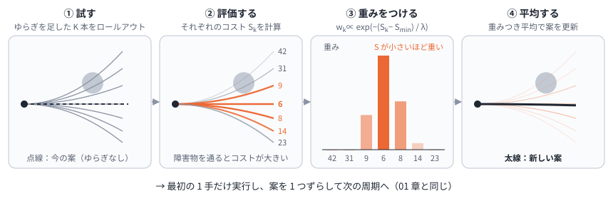
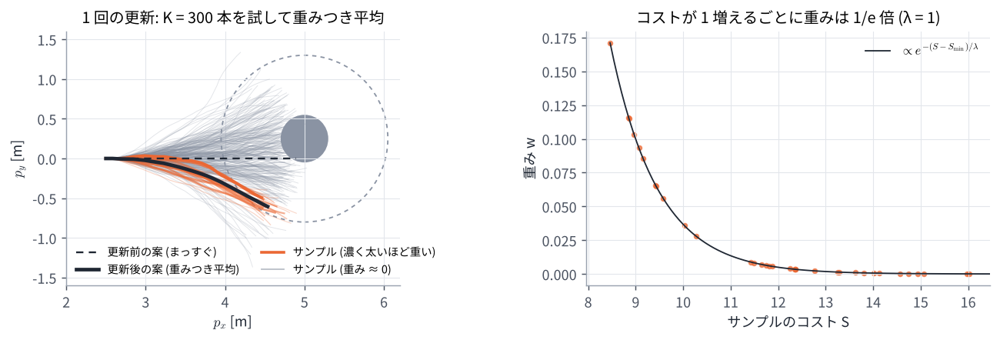
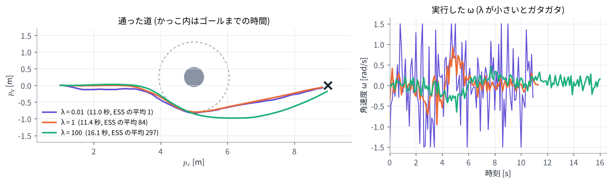

# 05. MPPI の考え方 (サンプリングと重み)

## この章のゴール

- MPPI の 1 周期 (試す → 評価する → 重みをつける → 平均する) を説明できる
- 重み $w_k \propto \exp(-(S_k - S_{\min}) / \lambda)$ を計算でき、$\lambda$ の意味が分かる
- 実効サンプル数 (ESS) で、重みの偏りを測れる
- MPPI が微分を使わない (段差のコストでも使える) 理由が分かる

> **つながり**
> [01 章](01_optimal_control.md) の最適制御問題を、微分を使わずに解きます。
> この章では「どう計算するか」に集中し、「なぜその式なのか」は [06 章](06_mppi_theory.md) で扱います。

---

## 0. この章で使う記号

| 記号 | 意味 |
| --- | --- |
| $U = (u_0, \dots, u_{N-1})$ | 今の案 (入力の列)。前回の答えを 1 ステップずらしたもの |
| $K$ | サンプル数 (試す入力の列の本数) |
| $\varepsilon_t^k \sim \mathcal N(0, \Sigma)$ | $k$ 本目のサンプルの、時刻 $t$ のゆらぎ (平均 0、共分散 $\Sigma$ の正規分布) |
| $S_k = S(U + E^k)$ | $k$ 本目の入力の列 $U + E^k$ でロールアウトしたときのコストの合計 ($E^k$ はゆらぎの列) |
| $\lambda$ | コスト差の目盛り (Nav2 のパラメータ名は `temperature`) |
| $w_k$ | $k$ 本目の重み (合計 1) |
| ESS | 実効サンプル数 $1 / \sum_k w_k^2$ |

## 1. 1 周期の流れ



1. **試す**: 今の案 $U$ に、ゆらぎ $\varepsilon_t^k$ を足した入力の列を $K$ 本作る
2. **評価する**: それぞれをモデルでロールアウトし、コスト $S_k$ を計算する
3. **重みをつける**: コストが低いものほど重くする

   ```math
   w_k = \frac{\exp\bigl(-(S_k - S_{\min}) / \lambda\bigr)}{\sum_{j=1}^{K} \exp\bigl(-(S_j - S_{\min}) / \lambda\bigr)}
   \qquad (S_{\min} = \min_j S_j)
   ```

4. **平均する**: 重みつき平均で案を更新する

   ```math
   u_t \leftarrow u_t + \sum_{k=1}^{K} w_k\, \varepsilon_t^k \qquad (t = 0, \dots, N-1)
   \qquad (1)
   ```

5. $u_0$ を実行し、案を 1 ステップずらして次の周期へ ([01 章](01_optimal_control.md) の receding horizon と同じ)

コードにすると次のとおりです。

```python
# U = (前回の答えを 1 ステップずらしたもの), 形は (N, 入力の数)
eps = normal(0, Sigma, size=(K, N))          # ゆらぎを K 組
S = [cost(rollout(x_hat, U + eps[k]))        # 全部試す (並列にできる)
     for k in range(K)]
w = exp(-(S - S.min()) / lam)                # 低コストほど重く
w = w / w.sum()
U = U + w @ eps                              # 重みつき平均
send(U[0])                                   # 最初の 1 手だけ実行
U = shift(U)
```

MPC と違い、微分 (ヤコビアン) も、連立方程式も、QP も出てきません。必要なのは **コストを計算できること** だけです。

## 2. 重みを手で計算する

入力が 1 つで、サンプルが 3 本の例です。ゆらぎとコストが次のとおりだったとします。

| サンプル | ゆらぎ $\varepsilon$ | コスト $S$ |
| --- | --- | --- |
| 1 | +0.5 | 10 |
| 2 | 0 | 11 |
| 3 | −0.5 | 14 |

$\lambda = 1$ なら、$S - S_{\min} = (0, 1, 4)$ なので

```math
\begin{gathered}
e^{-0} = 1, \quad e^{-1} = 0.368, \quad e^{-4} = 0.018 \\
\Longrightarrow \quad
w = \frac{(1,\ 0.368,\ 0.018)}{1.386} = (0.721,\ 0.265,\ 0.013)
\end{gathered}
```

更新量は $\sum_k w_k \varepsilon^k = 0.721 \times 0.5 + 0.265 \times 0 + 0.013 \times (-0.5) = +0.354$ です。
いちばん良いサンプル 1 の方向 (+0.5) へ、その 7 割ほど動きます。$\lambda$ を変えると次のようになります (演習 5)。

| $\lambda$ | 重み $w$ | 更新量 | ESS |
| --- | --- | --- | --- |
| 0.3 | (0.966, 0.034, 0.000) | +0.483 | 1.07 |
| 1 | (0.721, 0.265, 0.013) | +0.354 | 1.69 |
| 10 | (0.388, 0.351, 0.260) | +0.064 | 2.92 |

### 2.1 $S_{\min}$ を引く理由

重みの比は、コストの差だけで決まります。

```math
\frac{w_i}{w_j} = \exp\!\left( -\frac{S_i - S_j}{\lambda} \right)
```

全部のコストから同じ $S_{\min}$ を引いても、正規化したあとの重みは変わりません。
引くのは計算のためです。$S = 1000$ のようなコストで $e^{-1000}$ を計算すると、コンピュータでは 0 になってしまい (アンダーフロー)、全部 0 で割ることになります。$S_{\min}$ を引けば、いちばん良いサンプルの $e^{0} = 1$ が必ず残ります。

## 3. $\lambda$ の意味: コスト差の目盛り

$\lambda$ は、**どれくらいのコスト差を「大きな差」とみなすか** を決める目盛りです。

| $\lambda$ | コストが 1 違うときの重みの比 | ふるまい |
| --- | --- | --- |
| 0.1 | 0.00005 | 少しの差で重みが大きく変わる。いちばん良い 1 本だけを使うのに近い |
| 1 | 0.37 | 差が 1 で、重みが $1/e$ 倍 |
| 10 | 0.90 | ほぼ同じ重み。ただの平均に近い |

- $\lambda \to 0$: いちばん良いサンプルだけを選ぶ。そのサンプルはたまたま良かっただけかもしれないので、毎周期の答えがガタつく
- $\lambda \to \infty$: すべての重みが等しくなり、ゆらぎの平均 (ほぼ 0) しか足されないので、案がほとんど良くならない
- **ちょうどよい $\lambda$ はコストの大きさで変わります。** コストの重みを全部 10 倍にしたら、$\lambda$ も 10 倍にしないと同じふるまいになりません

Nav2 ではこの $\lambda$ を `temperature` というパラメータ名で設定します (既定値 0.3)。物理の式と形が似ていることから付いた名前で、物理的な温度の意味はありません。この教材では「コスト差の目盛り」と呼びます。

### 3.1 実効サンプル数 (ESS)

重みがどれだけ偏っているかは、**実効サンプル数** で測れます。

```math
\mathrm{ESS} = \frac{1}{\sum_{k=1}^{K} w_k^2}
```

全部同じ重み ($w_k = 1/K$) なら $K$、1 本に集中すれば 1 です。「実質的に何本分のサンプルを平均しているか」の目安になります。

下のデモで、$\lambda$ とゆらぎの大きさ $\sigma$ を動かして、重みと ESS の変わり方を見てください。コストは $S(u) = 2(u - 2)^2 + 8$ (最小点 $u = 2$)、今の案は $u = 0$ です。

<!-- demo:weights -->

> **HTML 版** では、ここでλ と σ を動かして重みを見るデモを動かせます → [Web 版の 05 章](https://mamoru1126.github.io/study_mpc_mppi/html/05_mppi_basics.html)

## 4. ロボットで 1 回だけ更新してみる

演習 5 で、2 輪ロボットに MPPI を 1 回だけ使います。人の 2.5 m 手前で、まっすぐ進む案から始め、$K = 300$、$\lambda = 1$ で更新します。



- 300 本のうち、人の近くを通るサンプルはコストが大きく、重みはほぼ 0 (灰色)
- 人の右下を回り込むサンプルに重みが集まる。重み 0.01 以上は 11 本で、ESS は 10.4
- 右の図のとおり、重みはコストが 1 増えるごとに $1/e$ 倍になる

更新前の案のコストは 120.1、更新後は 7.1 になりました。
面白いのは、**サンプルの中でいちばん良いもの (8.5) より、平均した案 (7.1) のほうが良い** ことです。良いサンプルどうしを平均すると、それぞれのランダムなでこぼこが打ち消し合うためです。

## 5. $\lambda$ を変えて動かす

同じ場面 (少しずれて立つ人) を、$\lambda$ を変えて最後まで走らせます (演習 5)。



| $\lambda$ | ゴールまで | ESS の平均 | $\omega$ の 1 ステップごとの変化の平均 |
| --- | --- | --- | --- |
| 0.01 | 11.0 秒 | 1.1 | 0.90 rad/s |
| 1 | 11.4 秒 | 84.5 | 0.18 rad/s |
| 100 | 16.1 秒 | 297.0 | 0.13 rad/s |

- $\lambda = 0.01$ は毎周期「いちばん良い 1 本」に乗り換えるので、角速度がガタガタになる
- $\lambda = 100$ はほぼ単純な平均になり、更新が進まないので、大回りしてゴールまで時間がかかる

## 6. ゆらぎの大きさ $\Sigma$ とサンプル数 $K$

- **$\Sigma$ (ゆらぎの大きさ)** は、どれだけ広く探すかを決めます
  - 小さすぎると、よけ道のような大きく違う案が見つからない
  - 大きすぎると、ほとんどのサンプルが悪くなって ESS が下がり、答えがガタつく
  - デモでは $\omega$ の標準偏差 0.8 rad/s、$v$ は その 0.35 倍。Nav2 では `vx_std`、`wz_std` で設定する
- **$K$ (サンプル数)** を増やすと、重みつき平均の推定が正確になります (誤差はおよそ $1/\sqrt{K}$ に比例。[06 章](06_mppi_theory.md))
  - 計算量は $K \times N$ 回のモデル計算に比例する。デモは $300 \times 30 = 9{,}000$ 回、Nav2 の既定は $1000 \times 56 = 56{,}000$ 回
  - サンプルどうしは独立なので、GPU や SIMD で並列に計算できる
- **入力の上下限**: サンプルを作ったあとに上下限で切り、切ったあとの値との差をゆらぎとして使います (デモと演習のコード)

## 7. 微分がいらない、という強み

MPPI はコストの値しか使わないので、次のようなコストでもそのまま使えます。

- **段差のあるコスト**: 「接触したら +1000」。[04 章](04_nonlinear_mpc.md) の NMPC は傾きが 0 で気づけなかったが、MPPI では接触するサンプルの重みがほぼ 0 になるので自然に避ける
- **表を引くだけのコスト**: 地図 (コストマップ) の値を足し合わせるなど
- **中身の分からないモデル**: シミュレータや学習したモデルでロールアウトしてもよい

一方、1 周期に $K$ 本のロールアウトが必要なので、MPC (1 周期に数回〜十数回のコスト評価) より計算は多くなります。

## 8. 実装でよく加える工夫

- **補正項**: 元の論文では、コストに $\lambda \sum_t u_t^\top \Sigma^{-1} \varepsilon_t^k$ を足してから重みを計算します ([06 章](06_mppi_theory.md))。Nav2 ではこの係数を `gamma` という別のパラメータにしています
- **平滑化**: 更新した入力の列はガタつきやすいので、なめらかにします。Nav2 は Savitzky–Golay フィルタを使います
- **反復**: 1 周期に 1〜3 を数回くり返すこともできます。Nav2 の既定は 1 回です

この教材のデモと演習の MPPI は、式 (1) だけの最も簡単な形です (補正項も平滑化もなし)。

## 演習 5

```bash
python exercises/ex05_mppi.py
```

2 節の表、4 節の 1 回の更新、5 節の $\lambda$ の比較を出力し、図を 2 枚作ります。コントローラ本体は `exercises/robot2d.py` の `MPPI` クラスです。

試してみること:

- `MPPI(..., sigma_w=0.8)` を 0.2 や 2.0 にすると、ESS と動きはどう変わるか
- `K=300` を 30 にすると、どうなるか

## 理解度チェック

1. コストが (5, 6, 9) の 3 本のサンプルの重みを、$\lambda = 1$ で計算すると?
2. 重みを計算するときに $S_{\min}$ を引くのはなぜか。引くと重みは変わるか?
3. $\lambda \to 0$ と $\lambda \to \infty$ で、MPPI はそれぞれどうふるまうか?
4. コストの重みを全部 2 倍にしたとき、同じふるまいにするには $\lambda$ をどうすればよいか?
5. ESS = 1 と ESS = $K$ は、それぞれどういう状態か?
6. MPPI が「接触したら +1000」というコストでも人を避けられるのはなぜか?
7. 平均した案が、どのサンプルよりも良くなることがあるのはなぜか?

<details markdown="1">
<summary>答えの例</summary>

1. 差は (0, 1, 4) で 2 節の例と同じなので、$w = (0.721, 0.265, 0.013)$。重みはコストの差だけで決まる。
2. $e^{-S}$ が小さくなりすぎて 0 になる (アンダーフロー) のを防ぐため。全部から同じ数を引くだけなので、正規化したあとの重みは変わらない。
3. $\lambda \to 0$: いちばんコストの低い 1 本だけを選ぶ (ガタつく)。$\lambda \to \infty$: 全部が同じ重みになり、ゆらぎの平均 (ほぼ 0) を足すだけなので、案がほとんど良くならない。
4. $\lambda$ も 2 倍にする。重みは $(S_i - S_j) / \lambda$ で決まるので、コストと $\lambda$ を同じ倍率にすれば変わらない。
5. ESS = 1: 重みが 1 本に集中している。ESS = $K$: 全部が同じ重み。
6. 接触するサンプルはコストが 1000 以上大きいので、重みが $e^{-1000/\lambda}$ 倍、つまりほぼ 0 になり、平均にほとんど入らないから。傾きを使わないので、段差でも問題にならない。
7. 良いサンプルにもそれぞれランダムなでこぼこがあり、平均するとそれが打ち消し合うから。

</details>

## もっと知りたい人へ

- G. Williams, P. Drews, B. Goldfain, J. M. Rehg, E. A. Theodorou, "Aggressive Driving with Model Predictive Path Integral Control," ICRA 2016. MPPI を実車 (1/5 スケールの車) で攻めた走行に使った論文。
- G. Williams et al., "Information Theoretic MPC for Model-Based Reinforcement Learning," ICRA 2017. この章の重みつき平均の形を、情報理論の考え方 ([06 章](06_mppi_theory.md)) から導いた論文。

---

前へ: [04 非線形 MPC](04_nonlinear_mpc.md) ｜ 次へ: [06 MPPI の理論](06_mppi_theory.md)
