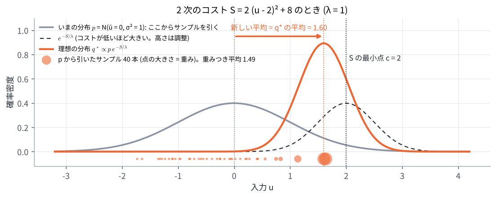
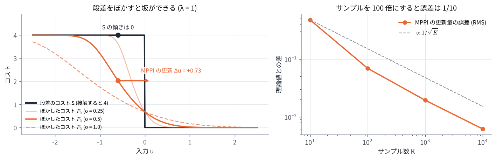

# 06. MPPI の理論 (なぜ重みつき平均なのか)

## この章のゴール

- 理想の分布 $q^* \propto p\, e^{-S/\lambda}$ が「コストを下げつつ、今のばらつきから離れすぎない」問題の答えであることが分かる
- 重点サンプリングで $q^*$ の平均を推定したものが、MPPI の更新式であることが分かる
- サンプルを増やすと、MPPI の更新は「ぼかしたコスト $F_\lambda$ の坂を下る」勾配法になることが分かる
- 2 次のコストなら、LM 法と同じ形 $\Delta u = -(A + \lambda\Sigma^{-1})^{-1} \nabla S$ になることを確かめる

> **つながり**
> [05 章](05_mppi_basics.md) の式の由来です。最後に [02 章](02_least_squares_gauss_newton.md) の LM 法と結びつけ、[07 章](07_comparison.md) の比較の土台にします。
> 式変形が多い章なので、まず各節の太字の結論と図を追い、導出は 2 回目に読むのがおすすめです。

---

## 0. この章で使う記号

| 記号 | 意味 |
| --- | --- |
| $V$ | サンプルした入力の列 (確率的に決まる) |
| $p(V)$ | 今のばらつき。平均が今の案 $U$、共分散 $\Sigma$ の正規分布 $\mathcal N(U, \Sigma)$ |
| $q(V)$ | 入力の列のばらつき (これを選ぶ) |
| $\mathbb E_q[\cdot]$ | $V \sim q$ のときの平均 (期待値) |
| $\mathrm{KL}(q \,\Vert\, p)$ | 2 つの分布の違いの大きさ (KL ダイバージェンス)。0 以上で、$q = p$ のときだけ 0 |
| $F_\lambda$ | コストをぼかしたもの (4 節) |
| $A$, $c$ | 2 次のコスト $S(u) = \frac12 (u - c)^\top A (u - c)$ の曲がり具合と最小点 (5 節) |

## 1. 1 本の入力の列から、入力の列の「ばらつき」へ

MPC は 1 本の入力の列 $U$ を選びました。MPPI は、**入力の列のばらつき (確率分布) $q$** を選ぶ問題に置きかえます。目標は次の 2 つのつり合いです。

- 平均のコスト $\mathbb E_q[S(V)]$ を下げたい
- 今のばらつき $p$ から離れすぎたくない (離れすぎると、手元のサンプルで評価できない)

```math
\min_{q}\ \ \mathbb E_q[S(V)] + \lambda\, \mathrm{KL}(q \,\Vert\, p)
\qquad (1)
```

$\lambda$ はつり合いの重みです。**この問題の答えは、次の分布になります。**

```math
q^*(V) = \frac{1}{\eta}\, p(V)\, e^{-S(V)/\lambda},
\qquad
\eta = \mathbb E_p\bigl[e^{-S(V)/\lambda}\bigr]
\qquad (2)
```

今のばらつき $p$ を、コストが低い入力の列ほど $e^{-S/\lambda}$ 倍だけ出やすくなるように作り直したもの、という意味です。$\eta$ は合計を 1 にするための定数です。

<details markdown="1">
<summary>導出 (2 行で済みます)</summary>

どんな $q$ についても、KL の定義 $\mathrm{KL}(q \Vert p) = \mathbb E_q[\log q - \log p]$ を使うと

```math
\begin{aligned}
\mathbb E_q[S] + \lambda\, \mathrm{KL}(q \Vert p)
&= \lambda\, \mathbb E_q\!\left[\log q - \log\bigl(p\, e^{-S/\lambda}\bigr)\right] \\
&= \lambda\, \mathbb E_q\!\left[\log q - \log(\eta\, q^*)\right] \\
&= \lambda\, \mathrm{KL}(q \Vert q^*) - \lambda \log \eta
\end{aligned}
```

KL は 0 以上で、$q = q^*$ のときだけ 0 なので、最小値 $-\lambda \log \eta$ を取るのは $q = q^*$ のときです。

</details>

$\lambda$ が大きいほど $p$ から離れにくく ($q^* \approx p$)、小さいほどコストの低い所に集中します。05 章で見た $\lambda$ のふるまいと同じです。

## 2. 新しい案 = 理想の分布の平均

実際に扱えるのは「平均 $U'$、共分散 $\Sigma$ の正規分布」だけです (サンプルを引くのも、実行するのも、平均の入力の列)。
そこで、$q^*$ にいちばん近い正規分布を選びます。**それは平均を $q^*$ の平均に合わせたもの** です。

```math
U' = \mathbb E_{q^*}[V]
\qquad (3)
```

<details markdown="1">
<summary>導出</summary>

$q^*$ と $\mathcal N(U', \Sigma)$ の違い $\mathrm{KL}(q^* \Vert \mathcal N(U', \Sigma))$ のうち、$U'$ に関係する部分は $\frac12 \mathbb E_{q^*}[(V - U')^\top \Sigma^{-1} (V - U')]$ だけです。
これを $U'$ で微分して 0 とおくと $\Sigma^{-1}\, \mathbb E_{q^*}[V - U'] = 0$、つまり $U' = \mathbb E_{q^*}[V]$ です。

</details>

2 次のコスト $S(u) = 2(u - 2)^2 + 8$、今の案 $u = 0$、$\sigma = 1$、$\lambda = 1$ の例で描くと次のようになります (演習 6)。



灰色の $p$ と点線の $e^{-S/\lambda}$ の積が、オレンジの $q^*$ です。$q^*$ の平均 1.6 が新しい案になります。
コストの最小点 $u = 2$ までは一気に行かず、今の案から 1.6 だけ進みます。この「一気に行かない」性質は 5 節で LM 法の慎重さとして説明します。

## 3. 重点サンプリング: $q^*$ から引けないので、$p$ から引いて重みで直す

$q^*$ の平均を求めたいのですが、$q^*$ から直接サンプルを引くことはできません ($\eta$ も分からない)。
そこで、引きやすい $p$ からサンプルを引き、$q^*$ と $p$ の比で重みをつけて平均します。これを **重点サンプリング** と呼びます。

```math
\begin{aligned}
\mathbb E_{q^*}[V]
&= \frac{\mathbb E_p\bigl[V\, e^{-S(V)/\lambda}\bigr]}{\mathbb E_p\bigl[e^{-S(V)/\lambda}\bigr]}
\approx \sum_{k=1}^{K} w_k V^k \\
w_k &= \frac{e^{-S_k/\lambda}}{\sum_{j} e^{-S_j/\lambda}}, \qquad V^k \sim p
\end{aligned}
```

$V^k = U + E^k$ ($E^k$ はゆらぎの列) で、重みの合計は 1 なので、

```math
U' \approx \sum_k w_k (U + E^k) = U + \sum_k w_k E^k
```

**これが 05 章の更新式 (1) そのものです。** 重みが $e^{-S_k/\lambda}$ なのは、$q^*$ が $p$ に $e^{-S/\lambda}$ をかけた形だからです。
上の図の下に並んだ点は、$p$ から引いた 40 本のサンプルで、点の大きさが重みです。重みつき平均は 1.49 で、本当の平均 1.6 に近い値になっています。

### 3.1 補正項 $\lambda\, u^\top \Sigma^{-1} \varepsilon$ の由来

元の論文では、1 節の $p$ を「今のばらつき $\mathcal N(U, \Sigma)$」ではなく、「入力を何もしないときのばらつき $\mathcal N(0, \Sigma)$」にしています。
すると、サンプルを引く分布 ($U$ のまわり) と $p$ (0 のまわり) がずれるので、重みにその比 $\mathcal N(V; 0, \Sigma) / \mathcal N(V; U, \Sigma)$ がかかり、コストに次の項が足されます。

```math
\tilde S_k = S_k + \lambda \sum_{t=0}^{N-1} u_t^\top \Sigma^{-1} \varepsilon_t^k
```

<details markdown="1">
<summary>導出</summary>

1 ステップぶんで、$V = U + \varepsilon$ とすると

```math
\begin{aligned}
\frac{\mathcal N(V; 0, \Sigma)}{\mathcal N(V; U, \Sigma)}
&= \exp\!\left(-\tfrac12 V^\top \Sigma^{-1} V + \tfrac12 \varepsilon^\top \Sigma^{-1} \varepsilon\right) \\
&= \exp\!\left(-U^\top \Sigma^{-1} \varepsilon - \tfrac12 U^\top \Sigma^{-1} U\right)
\end{aligned}
```

最後の項はサンプルによらない定数なので、正規化で消えます。残った $e^{-U^\top \Sigma^{-1} \varepsilon}$ を $e^{-S/\lambda}$ とまとめると、$e^{-(S + \lambda U^\top \Sigma^{-1} \varepsilon)/\lambda}$ になります。

</details>

この項は、入力を大きくする向きのゆらぎ ($u_t$ と同じ向きの $\varepsilon_t$) を少し罰し、入力を小さく保つ (省エネ) 方向に働きます。
Nav2 ではこの係数を $\lambda$ ではなく `gamma` という別のパラメータにしていて、ドキュメントでは「なめらかさ (大きい値) と省エネ (小さい値) のつり合い」と説明されています ([08 章](08_nav2_mppi.md))。

## 4. サンプルを増やすと: ぼかしたコストの坂を下る

サンプルを無限に増やしたとき、MPPI の 1 回の更新量 $\Delta u$ は何を計算しているのでしょうか。**答えは、次の「ぼかしたコスト」の坂を下る勾配法です。**

```math
\begin{gathered}
\Delta u = -\frac{\Sigma}{\lambda}\, \nabla F_\lambda(\bar u) \qquad (4) \\
F_\lambda(\bar u) = -\lambda \log \mathbb E_{\varepsilon \sim \mathcal N(0, \Sigma)}\!\left[ e^{-S(\bar u + \varepsilon)/\lambda} \right]
\end{gathered}
```

<details markdown="1">
<summary>導出 (正規分布の微分の性質を使います)</summary>

サンプル無限の更新量は $\Delta u = \mathbb E[\varepsilon\, e^{-S(\bar u + \varepsilon)/\lambda}] \,/\, \mathbb E[e^{-S(\bar u + \varepsilon)/\lambda}]$ です。
一方、$G(\bar u) = \mathbb E[e^{-S(\bar u + \varepsilon)/\lambda}] = \int \mathcal N(v; \bar u, \Sigma)\, e^{-S(v)/\lambda}\, dv$ を $\bar u$ で微分すると、
正規分布の密度の微分 $\nabla_{\bar u} \mathcal N(v; \bar u, \Sigma) = \mathcal N(v; \bar u, \Sigma)\, \Sigma^{-1} (v - \bar u)$ より

```math
\nabla G = \Sigma^{-1}\, \mathbb E\bigl[\varepsilon\, e^{-S(\bar u + \varepsilon)/\lambda}\bigr]
```

です。$F_\lambda = -\lambda \log G$ なので、$\nabla F_\lambda = -\lambda \nabla G / G = -\lambda\, \Sigma^{-1} \Delta u$ となり、式 (4) が得られます。
コストの微分 $\nabla S$ を一度も使っていないことに注意してください。

</details>

### 4.1 $F_\lambda$ は何か

$F_\lambda(\bar u)$ は、今の案 $\bar u$ のまわり (ゆらぎの幅 $\Sigma$ の範囲) のコストを、**低いほうを重視して平均したもの** です。
1 節の最小値 $-\lambda \log \eta$ と同じもので、統計物理の言葉では自由エネルギーと呼ばれます。

- $\lambda \to \infty$: $F_\lambda \to \mathbb E[S(\bar u + \varepsilon)]$。コストを正規分布でぼかしただけのもの
- $\lambda \to 0$: $F_\lambda$ はまわりのコストのいちばん低い値に近づく

つまり MPPI は、**元のコスト $S$ ではなく、それをぼかした $F_\lambda$ の坂を、歩幅 $\Sigma / \lambda$ で下っています**。

### 4.2 段差のコストでも坂ができる

「接触する側 ($u < 0$) は 4、しない側は 0」という段差のコストで確かめます。$\sigma = 0.5$、$\lambda = 1$、今の案 $\bar u = -0.6$ (接触する側) です (演習 6)。



- 元のコスト $S$ は $\bar u = -0.6$ で平らなので、傾きは 0。勾配を使う方法は動けない
- ぼかしたコスト $F_\lambda$ には右へ下る坂があり、式 (4) の更新量は $\Delta u = +0.726$。1 回の更新で $\bar u = +0.126$ (接触しない側) へ移る
- 実際の MPPI (サンプル $K$ 本) の更新量は次のとおり

| $K$ | 更新量の平均 | ばらつき (標準偏差) |
| --- | --- | --- |
| 10 | 0.480 | 0.410 |
| 100 | 0.719 | 0.069 |
| 1,000 | 0.726 | 0.019 |
| 10,000 | 0.726 | 0.006 |

サンプルを 100 倍にすると、ばらつきは約 1/10 になります ($1/\sqrt{K}$ に比例)。$K = 10$ では平均も小さめにずれています (重みを合計 1 に正規化することによる偏り)。

ゆらぎが届かないほど遠い段差は見えません。例えば $\bar u = -3$ ($6\sigma$ 離れている) なら、ほとんどのサンプルが段差を越えないので、$F_\lambda$ はほぼ平らで $\Delta u \approx 0$ です。**MPPI が見えるのは、ゆらぎ $\Sigma$ が届く範囲だけ** です。

下のデモで、$\bar u$、$\sigma$、$\lambda$ を動かして確かめてください。

<!-- demo:smooth -->

> **HTML 版** では、ここでぼかしたコストの坂を動かして見るデモを動かせます → [Web 版の 06 章](https://mamoru1126.github.io/study_mpc_mppi/html/06_mppi_theory.html)

## 5. 2 次のコストなら LM 法と同じ形

コストが 2 次関数 $S(u) = \frac12 (u - c)^\top A (u - c) + \text{定数}$ (曲がり具合 $A$、最小点 $c$) のときは、更新量を式で書けます。
正規分布 $\mathcal N(\bar u, \Sigma)$ に $e^{-S/\lambda}$ をかけたものは、また正規分布になるからです。

```math
\Delta u = -\left(A + \lambda \Sigma^{-1}\right)^{-1} \nabla S(\bar u)
\qquad (5)
```

<details markdown="1">
<summary>導出</summary>

$q^*(u) \propto \exp\bigl(-\frac12 (u - \bar u)^\top \Sigma^{-1} (u - \bar u) - \frac{1}{2\lambda} (u - c)^\top A (u - c)\bigr)$ は、精度行列 (共分散の逆) が $\Sigma^{-1} + A/\lambda$ の正規分布で、平均は

```math
m = \left(\Sigma^{-1} + A/\lambda\right)^{-1} \left(\Sigma^{-1} \bar u + (A/\lambda)\, c\right)
```

です。$\Delta u = m - \bar u = (\Sigma^{-1} + A/\lambda)^{-1} (A/\lambda)(c - \bar u) = (A + \lambda\Sigma^{-1})^{-1} A (c - \bar u)$ で、$\nabla S(\bar u) = A(\bar u - c)$ なので式 (5) になります。

</details>

02 章の LM 法と並べると、役割が 1 対 1 に対応します。

| | LM 法 (02 章) | MPPI (サンプル無限、2 次のコスト) |
| --- | --- | --- |
| 1 回の更新 | $\Delta z = -(J^\top J + \mu D)^{-1} J^\top r$ | $\Delta u = -(A + \lambda\Sigma^{-1})^{-1} \nabla S$ |
| 曲がり具合 | $J^\top J$ | $A$ |
| 勾配 | $J^\top r$ | $\nabla S$ |
| 慎重さ (減衰) | $\mu D$ | $\lambda \Sigma^{-1}$ |

つまり **MPPI は、減衰が $\lambda \Sigma^{-1}$ の LM 法** になっています。$\lambda$ が小さいか、ゆらぎ $\Sigma$ が大きいほど大胆 (ニュートン法に近い) で、$\lambda$ が大きいほど歩幅 $\Sigma/\lambda$ の慎重な勾配法になります。
演習 6 の数値 ($S = 2(u - 2)^2 + 8$、つまり $A = 4$、$c = 2$、今の案 $\bar u = 0$) で確かめます。

| $\sigma$ | $\lambda$ | 式 (5) | MPPI ($K = 10{,}000$) の平均 |
| --- | --- | --- | --- |
| 1 | 1 | 1.600 | 1.602 |
| 2 | 1 | 1.882 | 1.882 |
| 1 | 4 | 1.000 | 1.001 |

ニュートン法なら 1 回で最小点まで 2 だけ進みます。MPPI は減衰 $\lambda/\sigma^2$ のぶんだけ手前で止まります。
違いは、LM 法が $J^\top J$ と $J^\top r$ を微分で正確に計算するのに対し、MPPI はそれに当たるものをサンプルで推定していることです。

## 6. まとめ: 2 つの方法はどこが同じで、どこが違うか

| | MPC (ガウス・ニュートン法・LM 法) | MPPI |
| --- | --- | --- |
| 何を下るか | 元のコスト $S$ | ぼかしたコスト $F_\lambda$ |
| 傾きの求め方 | 微分で正確に | サンプルで推定 (誤差 $\propto 1/\sqrt{K}$) |
| 慎重さ | $\mu D$ (LM 法) | $\lambda \Sigma^{-1}$ |
| 段差のコスト | 傾きが 0 で見えない | ぼかすと坂になるので見える |
| 見える範囲 | 今の案のごく近く (微分) | ゆらぎ $\Sigma$ が届く範囲 |

どちらも「今の案のまわりを調べて、良くなる向きに少し直す」をくり返す方法で、違うのは **まわりの調べ方 (微分か、サンプルか)** です。この見方で 07 章の比較を読むと、得意・苦手の理由がよく分かります。

## 演習 6

```bash
python exercises/ex06_mppi_theory.py
```

段差のコストで式 (4) とサンプル数 $K$ の MPPI を比べ、2 次のコストで式 (5) を確かめ、図を 2 枚作ります。

試してみること:

- `ubar = -0.6` を `-1.5` や `-3.0` にすると、理論の更新量はどうなるか
- 段差の高さ (`step_cost` の 4.0) を 40 にすると、$F_\lambda$ の形と更新量はどう変わるか

## 理解度チェック

1. 式 (1) で KL の項を足すのはなぜか。$\lambda$ を大きくすると $q^*$ はどうなるか?
2. $q^*$ から直接サンプルを引かずに、その平均を求めるにはどうするか?
3. 補正項 $\lambda\, u^\top \Sigma^{-1} \varepsilon$ は、何と何の比から出てくるか?
4. 段差のコストで、勾配法は動けないのに MPPI が動けるのはなぜか?
5. 2 次のコストで $\lambda \to 0$ とすると、MPPI の更新量はどうなるか?
6. $K = 10$ と $K = 1000$ で、更新量の平均とばらつきが違うのはなぜか?

<details markdown="1">
<summary>答えの例</summary>

1. 今のばらつき $p$ から離れすぎない (手元のサンプルで評価できる範囲にとどまる) ようにするため。$\lambda$ を大きくすると $q^*$ は $p$ に近づき、更新が小さくなる。
2. 引きやすい $p$ からサンプルを引き、$e^{-S_k/\lambda}$ に比例する重みをつけて平均する (重点サンプリング)。
3. 論文で $p$ にした「入力なしのばらつき $\mathcal N(0, \Sigma)$」と、実際にサンプルを引く「今の案のまわりのばらつき $\mathcal N(U, \Sigma)$」の比。
4. MPPI は元のコストではなく、ゆらぎの幅でぼかしたコスト $F_\lambda$ の坂を下るから。段差もぼかすとなめらかな坂になる。
5. $\Delta u = -A^{-1} \nabla S(\bar u) = c - \bar u$ となり、ニュートン法と同じく 1 回で最小点へ行く。
6. 重みつき平均はサンプルで推定しているので、ばらつきは $1/\sqrt{K}$ に比例して小さくなる。また、重みを合計 1 に正規化するため、$K$ が小さいと平均も本当の値からずれる (偏り)。

</details>

## もっと知りたい人へ

- G. Williams, N. Wagener, B. Goldfain, P. Drews, J. M. Rehg, B. Boots, E. A. Theodorou, "Information Theoretic MPC for Model-Based Reinforcement Learning," ICRA 2017, pp. 1714–1721. 1〜3 節の導出の元。
- G. Williams, P. Drews, B. Goldfain, J. M. Rehg, E. A. Theodorou, "Information-Theoretic Model Predictive Control: Theory and Applications to Autonomous Driving," *IEEE Transactions on Robotics*, 34(6), pp. 1603–1622, 2018.
- E. A. Theodorou, E. Todorov, "Relative entropy and free energy dualities: Connections to Path Integral and KL control," IEEE CDC 2012. 1 節の KL と自由エネルギーの関係。

---

前へ: [05 MPPI の考え方](05_mppi_basics.md) ｜ 次へ: [07 MPC と MPPI の比較](07_comparison.md)
