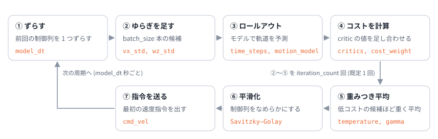

# 08. Nav2 の MPPI コントローラ

## この章のゴール

- Nav2 の MPPI コントローラのパラメータが、[05](05_mppi_basics.md)・[06 章](06_mppi_theory.md) の式のどこに当たるか説明できる
- ホライズン、サンプル数、制御周期の関係を数値で見積もれる
- critic (コストの項) の組み合わせ方と、調整の順番を知る

> **つながり**
> 05・06 章の式を、実際に使われているソフトウェアの設定に結びつけます。
> パラメータ名と既定値は、2026 年 11 月に確認した Nav2 のドキュメントによります。版によって変わることがあるので、使う版のドキュメントを必ず確認してください。

---

## 1. Nav2 の MPPI とは

Nav2 (ROS 2 のナビゲーションスタック) の MPPI コントローラは、大域的な経路に沿って進みながら、コストマップを見て障害物を避ける **局所的な軌道計画器** です。
ドキュメントでは、凸でなくても微分できなくてもよいコスト関数を使えることが、大きな利点として挙げられています。これは [05 章](05_mppi_basics.md) 7 節の「微分がいらない」強みそのものです。

運動モデルは、差動 2 輪 (`DiffDrive`)、全方向移動 (`Omni`)、アッカーマン (`Ackermann`) から選びます。この教材のロボットは `DiffDrive` に当たります。

1 周期の流れは次のとおりで、05 章の 1 周期とほぼ同じです。

05 章との違いは、⑥ の平滑化 (Savitzky–Golay フィルタ) が入ることと、⑤ の重みに補正項 (`gamma`) が入ることです。

## 2. パラメータと式の対応

| 記号 | パラメータ | 既定値 | 意味 |
| --- | --- | --- | --- |
| $\lambda$ | `temperature` | 0.3 | コスト差の目盛り。0 に近いほどコストの低い候補に重みが集中し、とても大きいとただの平均に近づく |
| $K$ | `batch_size` | 1000 | 1 回の更新で試す候補 (サンプル) の数。「1000 なら 50 Hz、2000 なら 30 Hz くらいで良い結果」とされている |
| $N$ | `time_steps` | 56 | ホライズンのステップ数 |
| $\Delta t$ | `model_dt` | 0.05 s | 1 ステップの時間。制御周期に合わせることが勧められている (例: 20 Hz なら 0.05 秒) |
| $\Sigma$ | `vx_std`, `vy_std`, `wz_std` | 0.2 ずつ | 入力ごとのゆらぎの標準偏差 ($\Sigma$ は対角行列) |
| 補正項の係数 | `gamma` | 0.015 | [06 章](06_mppi_theory.md) 3.1 節の $u^\top \Sigma^{-1} \varepsilon$ の係数。「なめらかさ (大きい値) と省エネ (小さい値) のつり合い」 |
| 反復回数 | `iteration_count` | 1 | 1 周期の更新回数。増やすより `batch_size` を増やすことが勧められている |
| $u_{\min}, u_{\max}$ | `vx_max`, `vx_min`, `wz_max` | 0.5, −0.35, 1.9 | 速度の上下限 (m/s, rad/s) |
| 加速度の上下限 | `ax_max`, `ax_min`, `az_max` | 3.0, −3.0, 3.5 | 加速度の上下限 (m/s², rad/s²) |
| $S$ | `critics` | — | 足し合わせるコストの項 (critic) の一覧 |

既定値は版によって違うことがあります (例えば `wz_std` を 0.4 と書いている版の資料もあります)。

## 3. 数字で関係をつかむ

**ホライズン**: $N \Delta t = 56 \times 0.05 = 2.8$ 秒。最高速度 0.5 m/s なら、1.4 m 先まで予測します。
ドキュメントでは、最高速度でホライズンの間に進む範囲が、コストマップに収まるようにすることが勧められています (収まらないと、速度が不自然に抑えられてしまうとされています)。

**計算量**: 1 回の更新で $1000 \times 56 = 56{,}000$ ステップぶんのモデル計算と、それぞれの点での critic の計算をします。20 Hz なら 1 秒に 112 万ステップです。Nav2 の実装は、これを配列演算 (Humble では xtensor というライブラリ) で、全部の候補をまとめて計算しています。

**制御周期と model_dt**: Humble の実装では、制御周期が `model_dt` と等しいとき、前回の制御列を 1 つずらす処理 ([01 章](01_optimal_control.md) 4.2 節のウォームスタート) が有効になります。

**ゆらぎの大きさ**: `vx_std` = 0.2 m/s は、最高速度 0.5 m/s の 40 % です。かなり大きくゆらがせて、広く探していることが分かります。

**temperature**: $\lambda = 0.3$ なら、コストが 0.3 違うと重みが $1/e$ 倍、1 違うと $e^{-1/0.3} = 0.036$ 倍です。これが「大きな差」かどうかは、critic の重み (コストの大きさ) で決まります ([05 章](05_mppi_basics.md) 3 節)。

## 4. critic = コストの項

Nav2 では、コスト $S$ を **critic** と呼ばれるプラグインの和で作ります。各 critic は、候補の軌道ごとに「重み × (項)$^{\text{べき}}$」を計算して足します (`cost_weight`, `cost_power`)。

| critic | 何を罰するか | 既定の重み | この教材のコストでは |
| --- | --- | --- | --- |
| `ConstraintCritic` | 速度などの制約を破ること | 4.0 | 上下限 (デモでは切っている) |
| `CostCritic` | コストマップの値 (障害物への近さ)。衝突は非常に大きな値 | 3.81 | 人の罰。衝突の値は「接触だけ罰」の段差に近い |
| `ObstaclesCritic` | 障害物までの距離 (`CostCritic` の代わりに使う) | 20.0 と 1.5 (危険と反発の 2 つ) | 人の罰 |
| `PathAlignCritic` | 経路からのずれ | 10.0 | 目標点からのずれ |
| `PathFollowCritic` | 経路の少し先の点へ進めていないこと | 5.0 | 目標点からのずれ |
| `PathAngleCritic` | 経路の方向と向きのずれ | 2.2 | — |
| `GoalCritic` | ゴールへの距離 (近くなってから効く) | 5.0 | 終端コスト |
| `GoalAngleCritic` | ゴールでの向きのずれ (近くなってから効く) | 3.0 | — |
| `PreferForwardCritic` | 後ろ向きに進むこと | 5.0 | ($v \ge 0$ に制限) |
| `TwirlingCritic` | 不必要に回ること (角速度の大きさ) | 10.0 | $q_\omega \omega^2$ |
| `VelocityDeadbandCritic` | 動き出せないほど小さい速度 | 35.0 | — |

どの critic を使うかは `critics` に並べて選びます。[01 章](01_optimal_control.md) のコストが「ずれ + 回りすぎ + 人への近さ」の和だったのと同じ考え方で、項を増やしたり重みを変えたりして「良い動き」を表します。

## 5. 調整の考え方

### 5.1 ドキュメントの勧め

- まず障害物の回避、次に経路の追従、最後に経路への整列の順に調整する
- 重みのつり合いを保つ。経路への整列を重くしすぎると、動く障害物をよけるために経路から離れることができなくなる
- 経路の追従が要らない用途なら、経路の critic を外してもよい

### 5.2 05・06 章の知識で考える

| 症状 | 考えられる原因 | 試すこと |
| --- | --- | --- |
| 指令がガタガタする | $\lambda$ が小さすぎて、たまたま良かった 1 本に引きずられている。ゆらぎが大きすぎる | `temperature` を上げる、`vx_std` / `wz_std` を下げる、`TwirlingCritic` を重くする |
| 反応が鈍い、よけ始めが遅い | $\lambda$ が大きすぎて平均に近い。ホライズンが短い | `temperature` を下げる、`time_steps` か `model_dt` を見直す |
| 狭い所の抜け道を見つけられない | ゆらぎが小さく、その道を通るサンプルがない | `vx_std` / `wz_std` を上げる、`batch_size` を増やす |
| critic の重みを変えたら性格が変わった | コストの大きさが変わり、$\lambda$ の効き方が変わった | `temperature` も合わせて調整する (コストを 2 倍にしたら $\lambda$ も 2 倍) |
| 計算が間に合わない | $K \times N$ が大きすぎる | `batch_size` か `time_steps` を減らす、制御周期を下げる |

## 6. この教材のデモとの違い

| | この教材のデモ | Nav2 |
| --- | --- | --- |
| コスト | 01 章の式 (目標点・回りすぎ・人) | critic の和 (コストマップを参照) |
| $\lambda$ | 1 (既定) | 0.3 (既定) |
| $K$, $N$, $\Delta t$ | 300, 30, 0.1 秒 | 1000, 56, 0.05 秒 |
| 補正項 | なし | `gamma` = 0.015 |
| 平滑化 | なし | Savitzky–Golay フィルタ |
| 加速度の制限 | なし | `ax_max` など |

コストの大きさが違うので、デモの $\lambda$ と Nav2 の `temperature` は直接は比べられません。

## 理解度チェック

1. `time_steps` = 56、`model_dt` = 0.05 のとき、ホライズンは何秒か。`vx_max` = 0.5 m/s なら何 m 先まで予測するか?
2. `temperature` を 0.3 から 0.03 にすると、どうなると予想されるか? 3 にすると?
3. critic の重みを全部 10 倍にしたら、`temperature` はどうすれば同じふるまいになるか?
4. `iteration_count` を増やすより `batch_size` を増やすことが勧められているのはなぜか。06 章の見方で考えてみよう
5. `gamma` の項は、06 章のどの式に当たるか?

答えの例

1. $56 \times 0.05 = 2.8$ 秒。$0.5 \times 2.8 = 1.4$ m 先まで。
2. 0.03: コストの低い少数の候補に重みが集中し (ESS が下がり)、指令がガタつきやすくなる。3: 重みがほぼ均等になり、更新が進みにくく、反応が鈍くなる。
3. `temperature` も 10 倍にする。重みはコストの差を $\lambda$ で割った値で決まるため。
4. 考え方の一例: 1 回の更新はぼかしたコストの坂を下る 1 歩で、その傾きの推定の正確さはサンプル数で決まる ([06 章](06_mppi_theory.md) 4 節)。同じ計算量なら、不正確な傾きで何歩も進むより、正確な傾きで 1 歩進み、残りは次の周期 (ウォームスタート) に任せるほうが安定しやすい。
5. 06 章 3.1 節の補正項 $\lambda \sum_t u_t^\top \Sigma^{-1} \varepsilon_t^k$ ($\lambda$ の代わりに `gamma` を係数にしたもの)。

## もっと知りたい人へ

- Nav2, "Model Predictive Path Integral Controller" (設定ガイド): <https://docs.nav2.org/configuration/packages/configuring-mppic.html>
- Nav2, nav2_mppi_controller の README (Jazzy, API ドキュメント内): <https://api.nav2.org/nav2-jazzy/html/md_nav2_mppi_controller_README.html>

---

前へ: [07 MPC と MPPI の比較](07_comparison.md) ｜ 次へ: [09 用語集](09_glossary.md)
